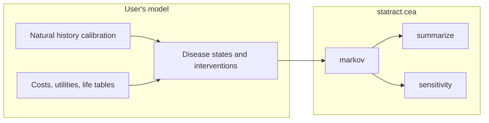

# Cost-effectiveness

Disease-agnostic utilities for **cost-effectiveness analysis (CEA)**. Following the R ecosystem, they keep **model building** and **result summaries** separate.

| Layer | Module | Closest in R |
|----|------------|----------------|
| Cohort Markov | `statract.cea.markov` | heemod (core only) |
| ICER / dominance | `statract.cea.summarize` | dampack `calculate_icers` |
| DSA / PSA post-processing | `statract.cea.sensitivity` | dampack / BCEA |

**No dependency on R, rpy2, heemod / dampack / BCEA, or hesim.** The implementation uses NumPy and Polars.

Disease states, cost tables, and calibrated natural history live outside the library (in the user's model).

## Design



- **In scope**: cohort STM with named states, discounting, `on_cycle` for events, ICER table (strong / extended dominance), NMB, one-way DSA, PSA → CE plane / CEAC / EVPI
- **Out of scope (V1)**: half-cycle correction, individual-level simulation, partitioned survival, EVPPI, TreeAge integration, disease-specific calibration (GAM and so on)

## Modules

### `markov` — cohort core

`simulate_cohort_markov(...)` steps the state distribution forward in 1-year (or any length) cycles. It returns discounted costs, QALYs, and LYs. Interventions such as tests or resections go inside `on_cycle(age, mass) -> (mass, extra_cost, extra_qaly)` (`extra_*` are **undiscounted**. The core applies discounting).

The initial distribution is normalized to 1 when it is finite, non-negative, and has a positive sum. A negative mass, an initial distribution whose sum is not positive, or a non-finite or negative `discount_rate` raises `ValueError`. Each row of the transition matrix must be non-negative and sum to 1. The mass returned by a callable or by `on_cycle` must keep the cohort total. The core does not clip negative mass to 0 and carry on.

### `summarize` — ICER table

`calculate_icers(cost, effect, strategies)` knows nothing about the model. It builds the frontier from each strategy's cost and effect only, and sets `status` to one of the following.

| status | Meaning |
|--------|------|
| `ND` | Not dominated (on the frontier) |
| `D` | Strongly dominated |
| `ED` | Extendedly dominated |

`net_monetary_benefit(cost, effect, wtp=...)` gives NMB = effect × WTP − cost.

### `sensitivity` — sensitivity analysis post-processing

The caller passes a function "parameter dict → `(costs, effects)`".

- `one_way_dsa` / `tornado_table`
- `run_psa` → `ce_plane` / `ceac` / `evpi`

`ceac` drops draws with a non-finite cost or effect from the probability. When no draw is finite, `prob_ce` is NaN, and the first strategy is not counted as the best.

Draw parameter distributions (for example, Gamma for costs) on the user side.

## Quickstart

The only dependencies are Python packages (`numpy`, `polars`). You do not need R.

```python
from statract.cea import (
    calculate_icers,
    one_way_dsa,
    run_psa,
    simulate_cohort_markov,
    ceac,
    evpi,
)
```

### 1. Three-state cohort Markov

The textbook Healthy → Sick → Dead model.

```python
import numpy as np
from statract.cea import simulate_cohort_markov

# rows = from, columns = to
P = np.array(
    [
        [0.94, 0.05, 0.01],  # Healthy
        [0.00, 0.90, 0.10],  # Sick
        [0.00, 0.00, 1.00],  # Dead
    ]
)

res = simulate_cohort_markov(
    states=("Healthy", "Sick", "Dead"),
    initial={"Healthy": 1.0},
    ages=range(50, 81),
    transition=P,
    utility={"Healthy": 1.0, "Sick": 0.6, "Dead": 0.0},
    cost={"Healthy": 0.0, "Sick": 1000.0, "Dead": 0.0},
    discount_rate=0.03,
    record_trace=True,
)
print(res.cost, res.qaly, res.ly)
print(res.trace.head())
```

#### Put interventions in `on_cycle`

Write events that state rewards alone cannot express, such as tests or resections, in the hook. The costs and QALYs it returns are **undiscounted**.

```python
def on_cycle(age: int, mass: np.ndarray):
    if age != 55:
        return mass, 0.0, 0.0
    m = mass.copy()
    # Example: record only the cost of "screening" for 10% of Healthy
    return m, 5000.0 * float(m[0]), 0.0

res = simulate_cohort_markov(
    states=("Healthy", "Sick", "Dead"),
    initial=[1.0, 0.0, 0.0],
    ages=range(50, 70),
    transition=P,
    utility=[1.0, 0.5, 0.0],
    discount_rate=0.03,
    on_cycle=on_cycle,
)
```

You can pass age-dependent transitions as a callable or as a `dict[age, matrix]`. The initial distribution is normalized to 1 if its sum is positive. A negative mass, a transition whose rows do not sum to 1, or an `on_cycle` that loses mass raises `ValueError`.

```python
def transition(age: int, mass: np.ndarray) -> np.ndarray:
    p_hs = min(0.02 + 0.001 * (age - 50), 0.2)
    P_age = P.copy()
    P_age[0, 0] = 1.0 - p_hs - 0.01
    P_age[0, 1] = p_hs
    return mass @ P_age
```

### 2. ICER table (model-agnostic)

```python
from statract.cea import calculate_icers, net_monetary_benefit

icers = calculate_icers(
    cost=[10_000, 25_000, 40_000],
    effect=[5.0, 6.0, 6.2],
    strategies=["A", "B", "C"],
)
print(icers)

nmb = net_monetary_benefit(
    icers["cost"],
    icers["effect"],
    wtp=5_000_000,
)
```

`status` is `ND` / `D` / `ED`. For an example of extended dominance, see the unit test `tests/test_cea_summarize.py`.

### 3. One-way DSA and PSA

```python
import numpy as np
from statract.cea import one_way_dsa, run_psa, ce_plane, ceac, evpi


def evaluate(params: dict[str, float]):
    # SOC vs INT (example)
    c0, e0 = 1000.0, 10.0
    c1 = params["c_int"]
    e1 = 10.0 + params["delta_e"]
    return [c0, c1], [e0, e1]


dsa = one_way_dsa(
    strategies=["SOC", "INT"],
    base_params={"c_int": 5000.0, "delta_e": 1.0},
    ranges={"c_int": (3000.0, 8000.0), "delta_e": (0.5, 1.5)},
    evaluate=evaluate,
    outcome="delta_nmb",
    comparator="SOC",
    wtp=50_000.0,
)
print(dsa)  # sorted by spread, descending → for the tornado plot

rng = np.random.default_rng(0)
draws = {
    "c_int": rng.normal(5000.0, 500.0, size=500),
    "delta_e": rng.normal(1.0, 0.1, size=500),
}
psa = run_psa(strategies=["SOC", "INT"], param_draws=draws, evaluate=evaluate)
plane = ce_plane(psa, comparator="SOC")
ac = ceac(psa, wtp=[0, 1e4, 5e4, 1e5])
voi = evpi(psa, wtp=[0, 1e4, 5e4, 1e5])
```

`ceac` computes probabilities only from draws with finite cost and effect. If all draws are non-finite, `prob_ce` is NaN.

## Next steps

- [Public teaching example cea_sicksicker](../examples/cea_sicksicker.md) — DARTH Sick-Sicker (Markov / ICER / DSA / PSA)
- [Mapping to R packages](vs-r.md)
- API: [markov](../api/cea/markov.md) · [summarize](../api/cea/summarize.md) · [sensitivity](../api/cea/sensitivity.md)
