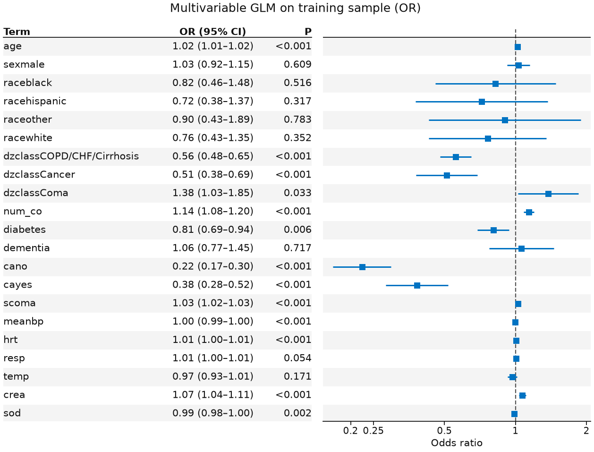
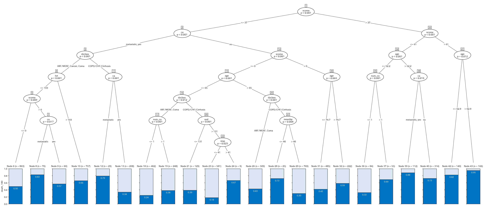
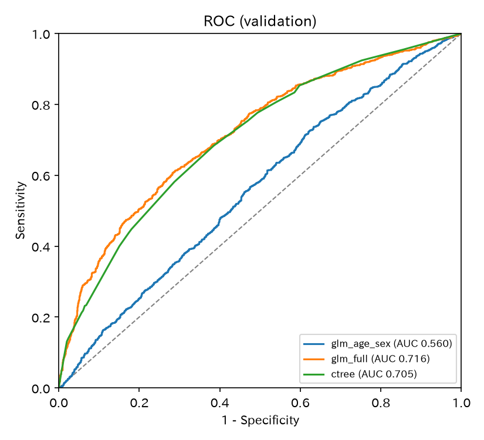
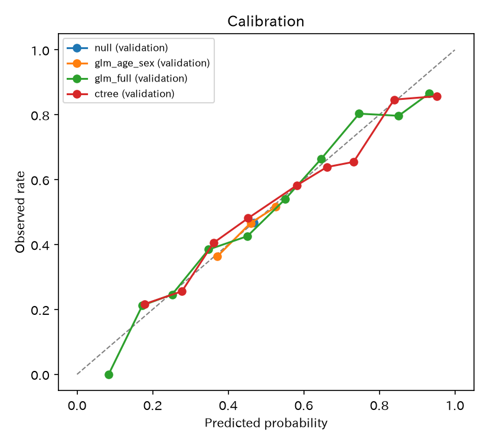
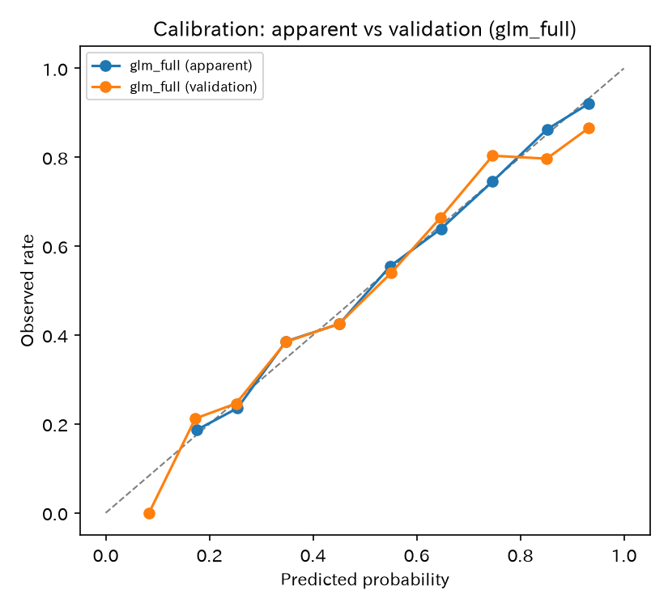
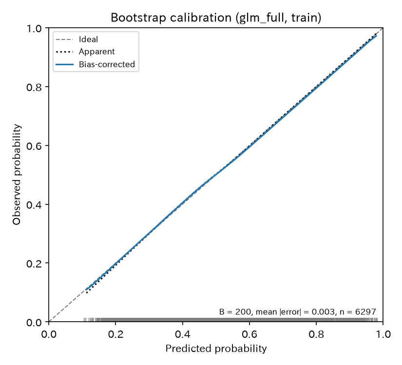
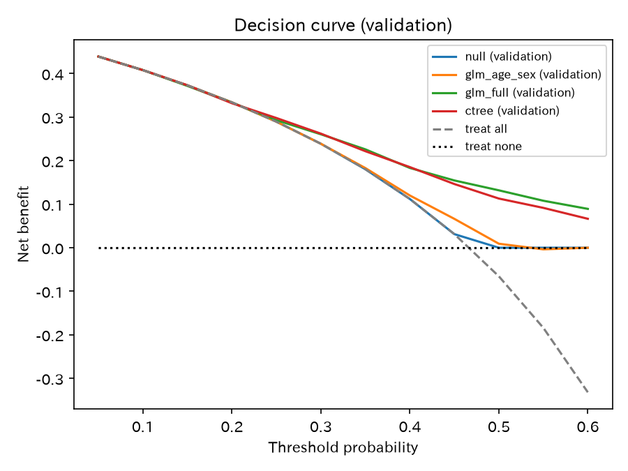

# 予測モデルの較正と DCA

`pred_support` — 二項 GLM / ctree / ROC / 較正 / ブートストラップ内部検証 / DCA

重症予後の **予測（点）モデル**。180 日死亡確率を学習データ（train）の二項一般化線形モデル（generalized linear model、GLM。ここではロジスティック回帰）と条件付き推測木（conditional inference tree、ctree）で推定し、分割（ホールドアウト）で取り分けた検証データで較正・Brier スコア・曲線下面積（area under the curve、AUC。[C 統計量と同じ値](../learn/discrimination-calibration.md#discrimination)）・決定曲線分析（decision curve analysis、DCA）を比べます。効果推定の [`logit_indo`](logit_indo.md) とは役割が違います。

[← ギャラリー](index.md) · [実行用ディレクトリと手順（GitHub）](https://github.com/mizuy/statract/tree/main/examples/pred_support)

解説は Learn の [第 9 章 過学習](../learn/overfitting.md)（分割とブートストラップ）、[第 10 章 識別と較正](../learn/discrimination-calibration.md)（ROC 曲線、較正、Brier スコア、DCA）、[第 12 章](../learn/trees-ensembles.md#ctree)（条件付き推測木）を参照してください。予測モデルの報告は TRIPOD+AI（Transparent Reporting of a multivariable prediction model for Individual Prognosis Or Diagnosis + Artificial Intelligence、[付録 B](../learn/reporting-guidelines.md#tripod)）に従います。

## 目的概説

較正曲線と DCA は予測確率 $\hat\pi$ の評価であり、ランダム化比較試験（randomized controlled trial、RCT）で推定するオッズ比（odds ratio、OR）とは別物です。`logit_indo` からホールドアウト較正を外したあとの受け皿として、公開の SUPPORT2 で `write_probability_artifacts` / `plot_calibration` / `plot_dca` / `binary_perf` / `threshold_tradeoff` を通します。学習標本の見かけ較正も併記し、見かけの成績の楽観を見えるようにします。受信者動作特性（receiver operating characteristic、ROC）曲線は `roc_curve` / `roc_test`（DeLong 法。出力は pROC と比べています）で、学習標本だけを使う内部検証は `validate_logistic` / `calibrate_logistic`（ブートストラップ。出力は rms と比べています）で示します。同じ予測因子で `conditional_tree`（条件付き推測木。出力は partykit::ctree と比べています）も当てはめ、加法的な GLM と、交互作用を自動で拾う木を同じ物差しで比べます。

## データと列の説明

| 項目 | 内容 |
|------|------|
| ソース | SUPPORT2（hbiostat teaching CSV、n=9105）。Knaus et al. / Harrell の重症予後コホート |
| 取得 | `build.py`（`https://hbiostat.org/data/repo/support2csv.zip`。失敗時は UCI CSV）。**fetch only** |
| 単位 | 患者 1 行。共変量欠損 109 行を除外（解析 n=8996） |

主な解析列（ドット付き原名は `num_co` / `d_time` に改名。Wilkinson の `.` と衝突しないようにする）:

| 列 | 意味 |
|----|------|
| `death_180` | 180 日死亡: `(death == 1) & (d_time <= 180)`。180 日未満の生存打ち切りは本表 0 件 |
| `age`, `sex`, `race` | 人口統計 |
| `dzclass` | 疾患クラス（ARF/MOSF, COPD/CHF/Cirrhosis, Cancer, Coma） |
| `num_co`, `diabetes`, `dementia`, `ca` | 併存・癌 |
| `scoma`, `meanbp`, `hrt`, `resp`, `temp`, `crea`, `sod` | day 3 付近の生理 |

`sps` / `aps` / `surv2m` / `surv6m` は既存 SUPPORT スコアなので **予測因子にしない**（リーク回避）。

## CQ と大まかな解析方針

**CQ** — SUPPORT2 の登録時（主に day 3）臨床・生理から 180 日死亡確率を二項 GLM で予測したとき、ホールドアウトでの較正・Brier・DCA は切片のみや年齢+性別と比べてどうか。同じ予測因子の ctree と比べてどうか。見かけ較正はホールドアウトより楽観的か。学習標本だけのブートストラップ内部検証はホールドアウトの結果を予測できるか。

方針:

1. flowchart で予後共変量の完全例を確定
2. Table 1（`hue=death_180_label`）。公開 API は `tableone(...)`
3. 層化 70/30（seed=2026）。**train だけ** `fit_glm(..., family="binomial")`: null、年齢+性別、多変量
4. 多変量 OR の `plot_forest(..., layout="table")`（train）
5. 同じ train と予測因子で `conditional_tree`（既定 alpha=0.05、minsplit=20、minbucket=7）
6. 検証確率を `write_probability_artifacts`（較正 / DCA / Brier。GLM と ctree を並べる）。AUC と閾値 0.40 の感度・特異度をモデル間で比較。見かけ vs 検証は `calibration_table` + `plot_calibration`。閾値 0.40 の `binary_perf` と `threshold_tradeoff`
7. 検証標本の ROC: `roc_curve`（AUC と DeLong 法による 95% 信頼区間［confidence interval、CI］）、`roc_test`（同じ患者での対応のある DeLong 検定。GLM 対 ctree）、`plot_roc`
8. train だけで多変量 GLM のブートストラップ内部検証: `validate_logistic`（楽観度補正後の Somers の Dxy［順位相関、C = Dxy/2 + 0.5］/ C / 較正の傾きなど）と `calibrate_logistic` + `plot_calibration_curve`（B=200、seed=2026）

## flowchart / tableone

共変量欠損で 109 行落ちるので flowchart を載せます。

### Flowchart

| 段 | flowchart キー | 対応基準 |
|----|----------------|----------|
| 共変量 | `Complete prognostic covariates` | 上記予測因子と `death_180` が非欠損 |

=== "図"

    ```mermaid
    flowchart TB
      classDef keep fill:#e8f5e9,stroke:#2e7d32,color:#111
      classDef drop fill:#f5f5f5,stroke:#9e9e9e,color:#333
      A["9,105 rows"]:::keep
      B["Analysis cohort<br/>8,996 rows"]:::keep
      X1["not Complete prognostic covariates<br/>excluded: 109 rows"]:::drop
      A --> B
      A -.-> X1
    ```

    同一内容は `assets/pred_support/mermaid_flowchart.md`（`pred_support_out/` から sync）。

=== "コード"

    ```python
    import io
    import polars as pl
    from statract.report.artifacts import mermaid_flowchart

    buf = io.StringIO()
    cohort = target.pp.flowchart(
        {
            "Complete prognostic covariates": pl.all_horizontal(
                [pl.col(c).is_not_null() for c in covs + ["death_180"]],
            ),
        },
        out=buf,
    )
    flow_text = buf.getvalue()
    mermaid_flowchart(flow_text, final_label="Analysis cohort")
    ```

### Table 1

=== "表"

    --8<-- "examples/assets/pred_support/table1_gt.md"

    [CSV](assets/pred_support/table1.csv)

=== "コード"

    ```python
    from statract import agg_category, agg_mean_sd, tableone

    t1 = tableone(
        cohort,
        params={
            "Age (years)": ("age", agg_mean_sd),
            "Sex": ("sex", agg_category),
            "Race": ("race", agg_category),
            "Disease class": ("dzclass", agg_category),
            "Comorbidities (n)": ("num_co", agg_mean_sd),
            "Diabetes": ("diabetes", agg_category),
            "Dementia": ("dementia", agg_category),
            "Cancer": ("ca", agg_category),
            "GCS coma score": ("scoma", agg_mean_sd),
            "Mean BP (mmHg)": ("meanbp", agg_mean_sd),
            "Heart rate": ("hrt", agg_mean_sd),
            "Respiratory rate": ("resp", agg_mean_sd),
            "Temperature (°C)": ("temp", agg_mean_sd),
            "Creatinine (mg/dL)": ("crea", agg_mean_sd),
            "Sodium (mEq/L)": ("sod", agg_mean_sd),
            "180-day death": ("death_180_label", agg_category),
        },
        hue="death_180_label",
        add_all=True,
        add_pvalue=True,
    )
    # write_tableone_artifacts は *_out/ への CSV/HTML 書き出し。Table 1 の公開 API は tableone()。
    ```

この Table 1 は結果（180 日死亡）で分けて P 値をつけています。この P 値は記述ではなく、変数を一つずつ比べた単変量の比較です（[Learn 1.6](../learn/descriptive.md#pvalue)）。

## メインの解析方法とそのコア

アウトカム $Y$ は 180 日死亡。学習標本で

$$
\operatorname{logit}(\pi)=\beta_0+\beta^\top x
$$

（`fit_glm(..., family="binomial")`）。OR forest は `plot_forest(..., layout="table")`（論文用白黒は `style="bw"`）。比較は $\operatorname{logit}(\pi)=\beta_0$ と $\operatorname{logit}(\pi)=\beta_0+\beta_1\mathrm{age}+\beta_2\mathrm{sex}$。予測確率 $\hat\pi$ を検証標本で評価。Brier スコアは $\mathrm{E}[(Y-\hat\pi)^2]$。決定曲線の正味の利益（net benefit）は閾値 $t$ で

$$
\mathrm{NB}=\frac{\mathrm{TP}}{n}-\frac{\mathrm{FP}}{n}\cdot\frac{t}{1-t}.
$$

ctree は各ノードで変数ごとに並べ替え検定を行い、多重性を補正（Šidák の方法）した P 値が最も小さく alpha を下回る変数で二分し、下回らなければ止まります（[Learn 12.1](../learn/trees-ensembles.md#ctree)）。終端ノード（葉）の死亡割合がそのまま予測確率になるので、確率は葉の数だけの段階値です。

閾値 0.40 の `binary_perf` は教学用であり、臨床カットオフの提案ではありません。

**ROC と DeLong。** AUC は $\Pr(\hat\pi_{\text{死亡}}>\hat\pi_{\text{生存}})$ に等しくなります（[Learn 10.1](../learn/discrimination-calibration.md#discrimination)）。DeLong 法は各患者の placement 値から AUC の分散を出し、2 モデルを同じ検証患者で比べるときは共分散まで入れた対応のある検定（`roc_test`、Z 統計量）になります（[Learn 17.6](../learn/diagnostic-metrics.md#compare)）。

**ブートストラップ内部検証（rms の `validate` / `calibrate`）。** 復元抽出した標本で当てはめ直したモデルの、その標本での指標（表の training 列）と元の学習標本全体での指標（test 列）の差を $B$ 回平均したものが楽観度（optimism）で、見かけの指標から引いたものが楽観度補正後の値です（[Learn 9.9](../learn/overfitting.md#bootstrap)）。rms の test 列はブートストラップの元の学習標本での値で、分割で取り分けた検証データではありません。較正の傾き（slope）は 1 未満なら予測が極端すぎる（過学習）ことを示します。表の Intercept は傾きと同時に推定した切片で、傾きを 1 に固定して見る Learn の較正の切片（calibration-in-the-large、[10.2](../learn/discrimination-calibration.md#calibration)）とは別の量です。分割（[Learn 9.6](../learn/overfitting.md#split)）とブートストラップは同じ問い（新しい患者でどれだけ性能が落ちるか）に別の手段で答え、前者は 1 回の分け方によるばらつきと検証データの小ささを抱え、後者はモデル選択の手順まで再現しないと楽観度を過小評価します。

## 結果

完全例 n=8996（fetch 9105 から 109 除外）。層化 70/30（seed=2026）で train n=6297、validation n=2699（検証の 180 日死亡率 0.467）。サイト掲載は `assets/pred_support/`。

### 多変量 GLM（train、OR）

=== "図"

    

=== "表"

    | term | exp_estimate | exp_conf_low | exp_conf_high | p_value |
    | --- | --- | --- | --- | --- |
    | age | 1.018 | 1.014 | 1.022 | 5.8e-20 |
    | dzclassCOPD/CHF/Cirrhosis | 0.557 | 0.478 | 0.649 | 5.7e-14 |
    | dzclassCancer | 0.511 | 0.378 | 0.690 | 1.2e-05 |
    | dzclassComa | 1.377 | 1.026 | 1.848 | 0.033 |
    | num_co | 1.139 | 1.082 | 1.200 | 7.6e-07 |
    | cano | 0.223 | 0.168 | 0.297 | 3.0e-25 |
    | scoma | 1.026 | 1.023 | 1.029 | 3.1e-54 |
    | crea | 1.070 | 1.035 | 1.106 | 6.1e-05 |

    抜粋（参照は因子の第 1 水準。`ca` は metastatic）。完全表: [CSV](assets/pred_support/glm_full_train.csv)

=== "コード"

    ```python
    from statract import fit_glm, plot_forest

    full_fit = fit_glm(train, FULL_FORMULA, family="binomial")
    full_tidy = full_fit.tidy(exponentiate=True)
    plot_forest(
        full_tidy,
        out / "figures" / "glm_full_forest.png",
        title="Multivariable GLM on training sample (OR)",
        xlabel="Odds ratio",
        layout="table",
    )
    ```

### 条件付き推測木（ctree、train）

=== "図"

    

    partykit の `plot` と同じ配置です。楕円は分割変数と Šidák の方法で補正した P 値、枝は分割条件、下段は終端ノード（葉）の 180 日死亡割合（濃い色）です。

    ```python
    plot_tree(tree, out / "figures" / "ctree.png")
    ```

=== "テキスト"

    ```text
    --8<-- "examples/assets/pred_support/ctree.txt"
    ```

    各行は `[ノード番号] 分割条件`。終端ノードは `: 180 日死亡割合 (n = 学習標本の人数)`。

=== "根ノードの検定"

    | term | statistic | p（Šidák） |
    | --- | --- | --- |
    | scoma | 447.3 | <1e-15 |
    | dzclass | 368.0 | <1e-15 |
    | ca | 197.1 | <1e-15 |
    | age | 69.4 | 1.2e-15 |
    | crea | 30.6 | 4.8e-07 |
    | hrt | 25.4 | 6.9e-06 |
    | meanbp | 21.4 | 5.5e-05 |
    | dementia | 12.3 | 0.0069 |

    抜粋（P<0.05）。完全表: [CSV](assets/pred_support/ctree_tests.csv)

=== "コード"

    ```python
    from statract import conditional_tree

    covs = ["age", "sex", "race", "dzclass", "num_co", "diabetes", "dementia", "ca",
            "scoma", "meanbp", "hrt", "resp", "temp", "crea", "sod"]
    tree = conditional_tree(train, "death_180", covs)
    print(tree.format())          # 上の「木」
    tree.tests()                  # 根ノードの変数選択の検定
    p_tree_val = tree.predict(val)
    ```

### GLM と ctree の比較（validation）

=== "表"

    | model | size | AUC | Brier | 平均予測 | 実測 | 感度（0.40） | 特異度（0.40） |
    | --- | --- | --- | --- | --- | --- | --- | --- |
    | glm_age_sex | 3 係数 | 0.560 | 0.2460 | 0.467 | 0.467 | 0.899 | 0.155 |
    | glm_full | 22 係数 | 0.716 | 0.2137 | 0.464 | 0.467 | 0.722 | 0.567 |
    | ctree | 22 終端ノード | 0.705 | 0.2178 | 0.464 | 0.467 | 0.753 | 0.531 |

    [CSV](assets/pred_support/model_compare_val.csv)

=== "コード"

    ```python
    from scipy.stats import rankdata
    from statract import binary_perf


    def auc(y, p):
        ranks = rankdata(p)
        n_pos = int(y.sum())
        n_neg = y.size - n_pos
        return (ranks[y == 1].sum() - n_pos * (n_pos + 1) / 2) / (n_pos * n_neg)


    for name, p_val in [("glm_full", p_full_val), ("ctree", p_tree_val)]:
        perf = binary_perf(y_val, (p_val >= 0.40).astype(int))
        print(name, auc(y_val, p_val), np.mean((p_val - y_val) ** 2),
              perf["sensitivity"], perf["specificity"])
    ```

### ROC と DeLong 検定（validation）

=== "図"

    

=== "表"

    | model | AUC | 95% CI（DeLong） |
    | --- | --- | --- |
    | glm_age_sex | 0.560 | 0.538–0.581 |
    | glm_full | 0.716 | 0.697–0.735 |
    | ctree | 0.705 | 0.685–0.724 |

    | 比較（対応あり DeLong） | AUC 差 | 95% CI | Z | p |
    | --- | --- | --- | --- | --- |
    | glm_full − ctree | 0.011 | −0.001 – 0.024 | 1.80 | 0.073 |
    | glm_full − glm_age_sex | 0.156 | 0.131 – 0.182 | 12.1 | <1e-30 |

    [AUC CSV](assets/pred_support/roc_auc_val.csv) · [検定 CSV](assets/pred_support/roc_test_val.csv)

=== "コード"

    ```python
    from statract import plot_roc, roc_curve, roc_test

    rocs = {
        "glm_age_sex": roc_curve(y_val, p_age),
        "glm_full": roc_curve(y_val, p_full_val),
        "ctree": roc_curve(y_val, p_tree_val),
    }
    for name, r in rocs.items():
        print(name, r.ci_auc())          # (low, auc, high)  DeLong
    t = roc_test(rocs["glm_full"], rocs["ctree"])   # 同じ y_val なので paired
    print(t.statistic, t.p_value, t.conf_int)
    plot_roc(rocs, out / "figures" / "fig_roc.png", title="ROC (validation)")
    ```

### Brier（validation）

=== "表"

    | model | split | brier | n |
    | --- | --- | --- | --- |
    | null (validation) | validation | 0.2489 | 2699 |
    | glm_age_sex (validation) | validation | 0.2460 | 2699 |
    | glm_full (validation) | validation | 0.2137 | 2699 |
    | ctree (validation) | validation | 0.2178 | 2699 |

    [CSV](assets/pred_support/table_brier.csv)

=== "コード"

    ```python
    from statract import write_probability_artifacts

    write_probability_artifacts(
        [
            {"name": "null (validation)", "y_val": y_val, "prob_val": p_null},
            {"name": "glm_age_sex (validation)", "y_val": y_val, "prob_val": p_age},
            {"name": "glm_full (validation)", "y_val": y_val, "prob_val": p_full_val},
            {"name": "ctree (validation)", "y_val": y_val, "prob_val": p_tree_val},
        ],
        out,
        positive_label="180-day death",
        dca_thresholds=np.linspace(0.05, 0.60, 12),
    )
    ```

### 較正（validation）

=== "図"

    

=== "表"

    | model | bin | n | pred_mean | obs_rate |
    | --- | --- | --- | --- | --- |
    | glm_full (validation) | 3 | 520 | 0.252 | 0.246 |
    | glm_full (validation) | 5 | 465 | 0.451 | 0.426 |
    | glm_full (validation) | 7 | 283 | 0.646 | 0.664 |
    | glm_full (validation) | 9 | 128 | 0.851 | 0.797 |

    抜粋。完全表: [CSV](assets/pred_support/table_calibration.csv)

    bin は予測確率を 0.1 刻みで区切った区間です（bin 3 は 0.2–0.3）。[Learn 10.2](../learn/discrimination-calibration.md#calibration) の人数が等しい 10 等分とは違い、予測確率の高い端の bin は人数が少なくなります。

=== "コード"

    ```python
    from statract import plot_calibration

    # 図は write_probability_artifacts が fig_calibration.png を書く
    plot_calibration(cal, out / "figures" / "fig_calibration.png")
    ```

### 較正（見かけ vs 検証）

=== "図"

    

=== "コード"

    ```python
    from statract import calibration_table, plot_calibration

    cal_app_val = pl.concat(
        [
            calibration_table(y_train, p_full_app, model="glm_full (apparent)", split="apparent"),
            calibration_table(y_val, p_full_val, model="glm_full (validation)", split="validation"),
        ]
    )
    plot_calibration(
        cal_app_val,
        out / "figures" / "fig_calibration_apparent.png",
        title="Calibration: apparent vs validation (glm_full)",
    )
    ```

    [CSV](assets/pred_support/table_calibration_apparent.csv)

### ブートストラップ内部検証（glm_full、train のみ）

=== "表"

    | 指標 | 見かけ | training | test | 楽観 | 楽観補正 |
    | --- | --- | --- | --- | --- | --- |
    | Dxy | 0.450 | 0.453 | 0.446 | 0.007 | 0.443 |
    | C（= Dxy/2 + 0.5） | 0.725 | 0.726 | 0.723 | 0.004 | 0.721 |
    | R2 | 0.206 | 0.209 | 0.202 | 0.006 | 0.200 |
    | Intercept | 0 | 0 | −0.006 | 0.006 | −0.006 |
    | Slope | 1 | 1 | 0.980 | 0.020 | 0.980 |
    | Emax | 0 | 0 | 0.005 | 0.005 | 0.005 |
    | Brier（B） | 0.210 | 0.209 | 0.211 | −0.001 | 0.211 |

    B=200（全回収束）。抜粋。完全表（D / U / Q / g / gp を含む）: [CSV](assets/pred_support/validate_logistic_train.csv)

=== "図"

    

    点線が見かけの lowess（loess の一種）による平滑化した較正曲線、青線が楽観度補正後。補正後曲線の平均絶対誤差は 0.0034、90% 点 0.0053（[CSV](assets/pred_support/calibrate_logistic_train.csv)）。

=== "コード"

    ```python
    from statract import calibrate_logistic, plot_calibration_curve, validate_logistic

    # 連続予測因子を標準化（モデルと指標は不変。ロジスティック当てはめの特異判定を避ける）
    cont = ["age", "num_co", "scoma", "meanbp", "hrt", "resp", "temp", "crea", "sod"]
    train_z = train.with_columns(
        [((pl.col(c) - pl.col(c).mean()) / pl.col(c).std()).alias(c) for c in cont]
    )
    val_tab = validate_logistic(train_z, FULL_FORMULA, B=200, seed=2026)
    cal_boot = calibrate_logistic(train_z, FULL_FORMULA, B=200, seed=2026)
    plot_calibration_curve(
        cal_boot,
        out / "figures" / "fig_calibrate_boot.png",
        title="Bootstrap calibration (glm_full, train)",
    )
    ```

### 決定曲線（DCA、validation）

=== "図"

    

=== "表"

    | threshold | glm_full | ctree | treat_all | treat_none |
    | --- | --- | --- | --- | --- |
    | 0.30 | 0.261 | 0.262 | 0.239 | 0 |
    | 0.40 | 0.183 | 0.185 | 0.112 | 0 |
    | 0.50 | 0.132 | 0.113 | −0.066 | 0 |
    | 0.60 | 0.089 | 0.067 | −0.332 | 0 |

    抜粋。完全表: [CSV](assets/pred_support/table_dca.csv)

=== "コード"

    ```python
    from statract import plot_dca

    plot_dca(dca, out / "figures" / "fig_dca.png", title="Decision curve (validation)")
    ```

### 閾値 0.40 の二値性能（glm_full、validation）

=== "表"

    | n | sensitivity | specificity | ppv | npv | accuracy |
    | --- | --- | --- | --- | --- | --- |
    | 2699 | 0.722 | 0.567 | 0.594 | 0.699 | 0.639 |

    [CSV](assets/pred_support/binary_perf_val.csv) · 閾値グリッド: [threshold_tradeoff_val.csv](assets/pred_support/threshold_tradeoff_val.csv)

=== "コード"

    ```python
    from statract import binary_perf, threshold_tradeoff

    perf = binary_perf(y_val, (p_full_val >= 0.40).astype(int))
    trade = threshold_tradeoff(
        y_val,
        p_full_val,
        thresholds=np.array([0.20, 0.30, 0.40, 0.50, 0.60]),
    )
    ```

## 解釈と解説

多変量 GLM の検証 Brier は約 **0.214**（null 0.249、年齢+性別 0.246）。較正ビンは対角線の近くに並び、高確率側でやや過大予測です。見かけ較正は同じモデルでもホールドアウトより甘く見える、というのが分割の教材です。この分割による検証では較正の切片と傾きを計算しておらず、[Learn 10.5](../learn/discrimination-calibration.md#report) が報告に挙げる二つは、下のブートストラップの Intercept と Slope（定義は上記のとおり少し違う）で見ています。

DCA では閾値 0.30–0.50 付近で多変量の正味の利益が全員治療（treat-all）と年齢+性別を上回ります。切片のみは（定数予測なので）閾値が有病率以下では treat-all と一致します。閾値 0.40 では感度約 0.72、特異度約 0.57です。

**GLM と ctree。** ctree（葉 22 個）は AUC 0.705、Brier 0.2178 で、多変量 GLM（22 係数、AUC 0.716、Brier 0.2137）に近い精度ですが、どちらの指標も GLM がわずかに上です。平均予測は両者とも 0.464 で実測 0.467 に近く、較正ビンもどちらもおおむね対角線の近くにあります。DCA は閾値 0.40 以下ではほぼ重なり、0.45 以上では GLM が上です。木の予測は段階値なので、高い閾値で確率の細かな序列が要る場面では GLM が有利です。閾値 0.40 では ctree の方が感度が高く（0.753 対 0.722）、特異度は低くなります（0.531 対 0.567）。

木が最初に分けるのは昏睡スコア `scoma`（37 以下とそれより上）で、その下で癌の有無、疾患クラス、年齢が繰り返し現れます。たとえば `scoma` > 61 かつ 62.9 歳を超えるノードは 180 日死亡 0.95、`scoma` 0・癌なし・65 歳以下の COPD/CHF/Cirrhosis でナトリウム > 131・呼吸数 41 以下のノードは 0.18 です。GLM は各変数の効果を全員に同じ大きさで足しますが、木は「どの部分集団で何が効くか」を直接示します。ただし木の分かれ目はデータが少し変わると動き、予測は段階値です。精度が近くても、木は危険の高い群を見てわかる形で示す補助として使い、主な予測モデルは GLM にするのが安全です（[Learn 12.6](../learn/trees-ensembles.md#choose)）。どちらも同じ 1 回の分割による検証であり、差の不確かさはブートストラップや交差検証で見るべきです。

**ROC と DeLong 検定。** 検証標本の AUC は GLM 0.716（95% CI 0.697–0.735）、ctree 0.705（0.685–0.724）で、対応のある DeLong 検定の差は 0.011（95% CI −0.001–0.024、P=0.073）です。GLM がやや上の方向ですが、この標本の大きさ（検証 2699 人）では差は有意でなく、差があっても 0.024 程度までに収まります。年齢+性別に対しては多変量 GLM が明確に上です（差 0.156、P<0.001）。ROC 曲線は偽陽性率 0.4 未満の側で GLM が上、それより右ではほぼ重なり、DCA で高い閾値ほど GLM が上になるのと同じ形です。

**ブートストラップ内部検証とホールドアウト。** 学習標本 6297 人・22 係数（1 変数あたりのイベント数［events per variable、EPV］は約 130。[Learn 9.4](../learn/overfitting.md#sample-size)）では楽観度は小さく、C は見かけ 0.725 から補正後 0.721、較正の傾きは 0.98（予測をわずか 2% 縮めればよい程度）です。補正後の C 0.721 は、実際のホールドアウト AUC 0.716（CI 0.697–0.735）の内側にあり、学習データだけの内部検証がホールドアウトの結果をよく予測しています。`calibrate_logistic` の補正後曲線もほぼ対角線上で（平均絶対誤差 0.003）、上の「見かけ vs 検証」の図でホールドアウトの高確率側に見えるずれ（予測 0.85–0.93 で実測 0.80–0.87）は、過学習よりも検証標本の高確率ビンの人数の少なさ（128 人、67 人）による揺れの寄与が大きいと読めます。rms 流の推奨は、データを分けずに全例で当てはめてブートストラップで楽観度を補正することです。ホールドアウトは 30% を学習に使わないぶん、モデルの精度も検証の精度も下がります。ただしここでのブートストラップは変数選択を含まない固定式の再当てはめなので、変数選択をしたなら選択手順ごとブートストラップする必要があります。

係数の向きは「ARF/MOSF と転移癌・昏睡・生理異常が重い」という記述と矛盾しません。糖尿病の OR が 1 を下回るなどは完全例の予測モデルであり、因果効果ではありません。外部検証ではなく、臨床用スコアでもありません。hbiostat 教学 CSV は **再配布せず fetch only** です。

## 実行と成果物

```bash
cd examples
task pred_support:all
```

既存の付随文書: [concept](https://github.com/mizuy/statract/blob/main/examples/pred_support/pred_support_concept.md) · [protocol](https://github.com/mizuy/statract/blob/main/examples/pred_support/pred_support_protocol.md) · [results](https://github.com/mizuy/statract/blob/main/examples/pred_support/pred_support_results.md) · [discussion](https://github.com/mizuy/statract/blob/main/examples/pred_support/pred_support_discussion.md)
