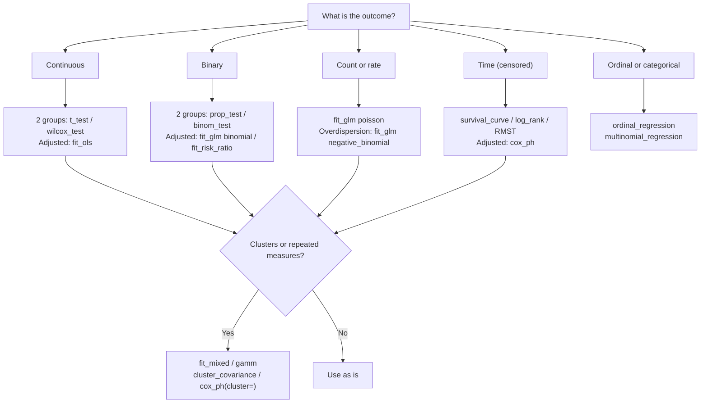

# Choosing a method

This page sums up the statistical methods in statract: when to use each one, which one to pick, and how to call it. For argument details, see the [API](../api/models/fit.md). For full worked analyses on real data, see the [example gallery](../examples/index.md).

## Decide these first

Three things mostly decide the method.

1. **Outcome type**: continuous, binary, ordinal, categorical (3 or more levels), count, or time to event (with censoring)
2. **Data structure**: independent, paired (before/after, matched pairs), or clustered (sites, repeated measures within patients)
3. **Goal**: compare groups, estimate an association, estimate a causal effect, or predict



## Quick reference

| Goal | Outcome | Method | Function |
|------|---------|--------|----------|
| Summarize baseline characteristics | Any | Table 1, SMD | `tableone` |
| Compare means of 2 groups | Continuous | t test | `t_test` |
| Compare distributions of 2 groups | Continuous, ordinal | Wilcoxon (Mann–Whitney) | `wilcox_test` |
| Compare proportions | Binary | Test of proportions, exact binomial | `prop_test`, `binom_test` |
| Compare paired binary data | Binary | McNemar | `mcnemar_test` |
| Adjust for multiple comparisons | P values | Holm, BH, and others | `p_adjust` |
| Estimate an adjusted association | Continuous | Linear regression | `fit_ols` |
| Estimate an adjusted association | Binary, count, positive continuous | GLM | `fit_glm` |
| Estimate a risk ratio | Binary | Modified Poisson, log-binomial | `fit_risk_ratio` |
| Adjusted risk difference or risk ratio | Binary, count | Regression standardization with GLM | `standardize_glm` |
| Ordered outcome | Ordinal | Proportional odds model | `ordinal_regression`, `brant_test` |
| Unordered outcome | Categorical | Multinomial logistic | `multinomial_regression` |
| Model a nonlinear association | Continuous, binary, time | Splines | `rcs(age, 4)` in the formula, `spline_effect` |
| Model a nonlinear association (penalized) | Continuous, binary, count | Additive model | `gam` |
| Account for sites or repeated measures | Continuous, binary, count | Mixed model | `fit_mixed`, `gamm` |
| Plot and compare survival curves | Time | Kaplan–Meier, log-rank | `survival_curve`, `log_rank` |
| Estimate a hazard ratio | Time | Cox | `cox_ph` |
| Compare by mean survival time | Time | RMST | `restricted_mean_survival` |
| PH does not hold | Time | AFT | `accelerated_failure` |
| Competing events | Time | CIF, Gray's test, Fine–Gray | `cumulative_incidence`, `fine_gray_regression` |
| Matched sets | Binary | Conditional logistic | `conditional_logit` |
| Treatment effect (observational study) | Any | Matching, IPTW, standardization | `match_sample`, `propensity_weights`, `standardize_glm`, `standardize_cox` |
| Evaluate a prediction model | Binary, time | ROC, internal validation, calibration, DCA | `roc_curve`, `validate_logistic`, `calibrate_logistic`, `decision_curve_table` |
| Handle missing data | Any | Multiple imputation | `impute_chained`, `pool` |
| Find splitting rules | Continuous | Conditional inference tree | `conditional_tree` |
| Run a cost-effectiveness analysis | Cost, QALY | Markov, ICER | `statract.cea` |

## Description: Table 1

**When**: The first table of a paper. You want baseline characteristics by group.

**How**: Pass `tableone` a mapping from columns to summary functions. `hue` is the group. `add_pvalue=True` adds P values between groups. `add_smd=True` adds standardized mean differences (SMD).

```python
from statract import agg_category_np, agg_mean_sd, agg_median_iqr, tableone

tableone(
    frame,
    {
        "Age": ("age", agg_mean_sd),
        "Length of stay": ("los", agg_median_iqr),
        "Sex": ("sex", agg_category_np),
    },
    hue="arm",
    add_smd=True,
)
```

**Note**: P values are not recommended in Table 1 of an RCT. Use SMD to see the size of imbalance. In observational studies, an SMD above 0.1 is a rough sign that adjustment is needed.

See [Table One](../tableone/overview.md) for details.

## Comparing 2 groups: basic tests

**When**: You compare 2 groups without adjustment. This is common for the primary analysis of an RCT, or as support for descriptive results.

| Data | Method | Call |
|------|--------|------|
| Continuous, roughly normal | Welch's t test (default) | `t_test(x, y)` |
| Continuous, outliers or skew | Wilcoxon rank sum | `wilcox_test(x, y, conf_int=True)` |
| Continuous, before and after | Paired t / signed rank | `t_test(x, y, paired=True)`, `wilcox_test(x, y, paired=True)` |
| Proportions in 2 groups | Difference in proportions | `prop_test([x1, x2], [n1, n2])` |
| Proportion and interval in 1 group | Exact binomial (Clopper–Pearson) | `binom_test(x, n)` |
| Binary, before and after | McNemar | `mcnemar_test(x, y)` |

If you test several time points or outcomes, adjust with `p_adjust(pvalues, "holm")`. For FDR, use `"BH"`.

**Note**: If you need to adjust for confounding, move on to regression. Results match R functions such as `t.test` and `wilcox.test`.

Example: [Basic tests for a 2-arm RCT](../examples/htest_licorice.md)

## Regression: adjusted associations

### Choose by outcome

| Outcome | Model | Call | How to read the coefficient |
|---------|-------|------|-----------------------------|
| Continuous | Linear regression | `fit_ols(frame, "y ~ x + age")` | Difference in means |
| Binary | Logistic | `fit_glm(frame, "y ~ x", family="binomial")` | `exp` gives the odds ratio |
| Count or rate | Poisson | `fit_glm(frame, "n ~ x", family="poisson", offset="log_years")` | `exp` gives the rate ratio |
| Count, overdispersed | Negative binomial (NB2) | `fit_glm(frame, "n ~ x", family="negative_binomial")` | `exp` gives the rate ratio |
| Positive continuous, right-skewed | Gamma | `fit_glm(frame, "cost ~ x", family="gamma")` | Inverse link |
| Binary, risk ratio wanted | Modified Poisson | `fit_risk_ratio(frame, "y ~ x + age")` | Risk ratio |
| Ordinal (such as severity) | Proportional odds | `ordinal_regression(frame, "grade ~ x", levels=["none", "mild", "severe"])` | `exp` gives the cumulative odds ratio |
| 3 or more unordered levels | Multinomial logistic | `multinomial_regression(frame, "subtype ~ x + age")` | `exp` gives the relative risk ratio versus the reference level |

See [Wilkinson formulas](../models/formula.md) for formula syntax. The first level of a categorical variable is the reference. Get the coefficient table with `fit.tidy()`. As in broom, `fit.tidy(exponentiate=True)` turns `estimate`, `conf_low`, and `conf_high` into odds, rate, or hazard ratios; `std_error` and `p_value` stay on the log scale.

### Choose the effect measure

When the outcome is common (roughly 10% or more), the odds ratio from logistic regression is larger than the risk ratio. Pick the measure your readers will understand best.

| What you want | Call |
|---------------|------|
| Adjusted odds ratio | `fit_glm(..., family="binomial")` |
| Adjusted risk ratio | `fit_risk_ratio(frame, "y ~ arm + age")`. The default is modified Poisson (HC0). `method="log-binomial"` is also available |
| Adjusted (marginal) risk difference, risk ratio, odds ratio | `standardize_glm(frame, "y ~ arm * age + sex", values={"arm": [0, 1]})` then `.tidy(contrast="difference", reference=0)` |

`standardize_glm` sets everyone's treatment to 0 and then to 1, and averages the predicted probabilities. Even with interactions in the model, you get one summary number.

**Note**: For ordinal logistic regression, check the proportional odds assumption with `brant_test(fit)`. If it fails, consider multinomial logistic regression.

### Choose the standard errors

If you doubt the model assumptions, keep the coefficients and replace only the variance.

| Situation | Covariance | Call |
|-----------|------------|------|
| Variance is not constant | Robust (HC) | `hc_covariance(fit, kind="HC3")` |
| Correlation within sites or patients | Cluster-robust | `cluster_covariance(fit, "site", data=frame)` |
| Autocorrelation in a time series | Newey–West | `newey_west_covariance(fit, lags=4)` |
| You do not want to rely on analytic formulas | Bootstrap | `bootstrap_covariance(fit, n=2000, seed=1)` |

To build a coefficient table with the replaced variance, use `coefficient_test(fit, cov)`.

### Check and compare models

| What to check | Function |
|---------------|----------|
| Compare nested models | `likelihood_ratio_test(full, reduced)`, `wald_test(full, reduced)` |
| Multicollinearity | `check_collinearity(fit)` (VIF) |
| Heteroscedasticity | `breusch_pagan_test(fit)` |
| Autocorrelation | `durbin_watson_test(fit)`, `breusch_godfrey_test(fit)` |
| Misspecified functional form | `ramsey_reset_test(fit)` |

## Nonlinear associations: splines and additive models

**When**: The effect of age or a lab value may not be linear. You do not want to fix a cutoff in advance.

### Splines

**How**: Write `rcs(age, 4)` (restricted cubic spline with 4 knots) in the formula. It works with `fit_glm`, `fit_ols`, and `cox_ph`. You can also write `ns(age, df = 3)` and `bs(age, df = 5)`.

```python
from statract import fit_glm, plot_spline_effect, spline_effect, spline_test

fit = fit_glm(frame, "death ~ rcs(age, 4) + sex", family="binomial")
print(spline_test(fit, "rcs(age, 4)"))  # tests for the overall and nonlinear parts
curve = spline_effect(fit, frame, "age", at=range(40, 86), reference=60, exponentiate=True)
plot_spline_effect(curve)  # OR curve with age 60 as the reference
```

**Note**: 3 to 5 knots are enough. If the P value for the nonlinear part is large, a linear model is fine. See [Wilkinson formulas](../models/formula.md#splines) for the syntax.

### Additive models

**When**: You want the data to decide the smoothness. You want 2 or more smooths, or a smooth surface over 2 variables.

**How**: Pass smooth terms (`smooth`) to `gam`. REML picks the smoothness automatically.

```python
from statract import gam, smooth

fit = gam(frame, "y", [smooth("age")], predictors=["arm"], family="binomial")
print(fit.smooth_table())
```

**Note**: Compare the model with smooths and the linear model using `compare_gams` (AIC, deviance change, and an approximate test). If a smooth's `edf` is close to 1, a straight line is enough.

## Clusters and repeated measures: mixed models

**When**: You have multicenter data, repeated measures on the same patients, or variation between raters.

**How**: Write the random effects in the formula.

| Data | Call |
|------|------|
| Continuous, random intercept for site | `fit_mixed(frame, "y ~ x + (1 | site)")` |
| Repeated measures, slopes also vary by person | `fit_mixed(frame, "y ~ time + (1 + time | id)")` |
| Binary | `fit_mixed(frame, "y ~ x + (1 | site)", family="binomial")` |
| Overdispersed counts | `fit_mixed(frame, "n ~ x + offset(log(years)) + (1 | site)", family="negative_binomial")` |
| Counts with many zeros | `zero_inflation=True` or `hurdle=True` |
| Nonlinear terms and random effects | `gamm(frame, "y", [smooth("x")], random="(1 | site)", family="binomial")` |
| Survival time, random intercept for site (frailty) | `cox_mixed(frame, "Surv(time, event) ~ x + (1 | site)")` |

Check the size of between-site variation with `fit.variance_table()`. For logistic models, `median_odds_ratio` puts it on the odds ratio scale.

**Note**: If you only want the average effect across sites, `fit_glm` with `cluster_covariance` is enough. Use a mixed model when the variation between sites is itself of interest.

Examples: [Mixed logistic model for a multicenter RCT](../examples/logit_indo.md), [Count GLMM for an epilepsy RCT](../examples/glmm_epil.md), [Linear mixed model for repeated measures](../examples/lmm_pbcseq.md)

## Survival analysis

### Curves and tests

**When**: Time-to-event outcomes with censoring (death, recurrence).

```python
from statract import log_rank, plot_survival, survival_curve

curve = survival_curve(frame, "time", "event", by="arm")
print(curve.at([1, 3, 5]))       # survival proportion at each time point
print(log_rank(frame, "time", "event", by="arm"))
```

Plot with `plot_survival`. It also shows the number at risk.

### Cox regression

**When**: You want a hazard ratio adjusted for covariates.

```python
from statract import cox_ph, proportional_hazards_test

fit = cox_ph(frame, "Surv(time, event) ~ arm + age + sex")
print(fit.tidy())
print(proportional_hazards_test(fit))
```

| Situation | How |
|-----------|-----|
| Baseline hazard differs by stratum | Add `strata(center)` to the formula |
| Several eyes from the same patient, and similar | `cluster(id)` or `cluster=` (Lin–Wei robust variance) |
| Time-varying covariates or effects | Split follow-up with `split_follow_up` and pass `entry` |
| Delayed entry | `entry=` |
| Hazard varies by hospital, and that variation is of interest (frailty) | `cox_mixed(frame, "Surv(time, event) ~ arm + (1 | hospital)")` |

**Note**: Check PH (proportional hazards) with `proportional_hazards_test`. For covariates with small P values, stratify, split by time, or consider AFT. To output a full set of diagnostic plots, use `write_cox_diagnostic_suite`.

### RMST: compare by mean survival time

**When**: PH does not hold, so the hazard ratio cannot be summarized as one number. You want to say "how many more months people live on average within 5 years."

Use `restricted_mean_survival(frame, "time", "event", by="arm", tau=5)`. `.arms` holds the RMST for each group, and `.contrasts` holds the difference and ratio. Set `tau` to a time point with enough follow-up in both groups. For covariate-adjusted RMST, use `standardize_cox(..., measure="rmean")`.

### When PH does not hold: AFT

Use `accelerated_failure(frame, "Surv(time, event) ~ arm", distribution="weibull")`. Read the coefficients as "how many times longer the time becomes." Distributions include `weibull`, `exponential`, `lognormal`, and `loglogistic`.

### Competing risks

**When**: Before the event of interest (for example, liver death), another event (for example, transplant) ends observation. Plotting 1 − survival from KM overestimates the incidence.

| What you want | Call |
|---------------|------|
| Cumulative incidence (CIF) and Gray's test | `cumulative_incidence(frame, "time", "status", by="arm")` |
| Values for the CIF plot | `survival_curve(..., kind="aalen_johansen")` |
| Subdistribution hazard ratio | `fine_gray_regression(frame, "Surv(time, status) ~ arm + age", cause=1)` |
| Cause-specific hazard ratio | `cox_ph` with other causes treated as censored |

In `status`, 0 is censored and 1 or more is a cause. Cause-specific hazards suit etiologic questions. Fine–Gray suits prognostic prediction.

### Matched sets

For 1:k matched case-control data or binary outcomes in matched pairs, use `conditional_logit(frame, "y ~ x + strata(set)")`.

Examples: [Survival curves and Cox regression](../examples/surv_colon.md), [Competing risks analysis](../examples/cif_pbc.md), [PH tests and AFT models](../examples/aft_rotterdam.md), [Cluster-robust Cox](../examples/cox_retinopathy.md)

## Causal inference: treatment effects in observational studies

**When**: Treatment was not randomized, and you compare groups with different backgrounds. Every method assumes that measured confounders explain the difference.

| Method | What it estimates | Call |
|--------|-------------------|------|
| Propensity score matching | ATT (effect in the treated) | `match_sample(frame, "treat", covs, method="nearest", distance="logit", caliper=0.2)` |
| IPTW | ATE, ATT, ATO | `propensity_weights(frame, "treat ~ age + sex + stage", estimand="ATE", stabilize=True, trim=0.99)` |
| Regression standardization with GLM | Marginal risk difference and risk ratio | `standardize_glm(frame, "y ~ treat * age + sex", values={"treat": [0, 1]})` |
| Regression standardization with Cox | Marginal survival curves, their difference, RMST | `standardize_cox(frame, "Surv(time, status) ~ treat * age + sex", values={"treat": [0, 1]}, times=[1, 3, 5])` |

After matching, check SMD with `matched.balance()` and `matched.love_plot()`.

For IPTW, follow these steps.

1. Build weights with `ipw = propensity_weights(...)`.
2. Check SMD after weighting with `ipw.balance(threshold=0.1)` and `ipw.love_plot("love.png")`. Also check that `ipw.effective_sample_size()` is not too small.
3. Estimate the effect with `ipw.effect("death", measure=["difference", "ratio"])` (weighted group means), or fit an outcome model with `weighted_glm(ipw, "death ~ treat", family="binomial")`. Their default variance (`vcov="asympt"`) includes the estimation of the propensity score.
4. For Cox, pass the `weights` column of `ipw.frame()` to `cox_ph(..., weights="weights")`. Non-integer weights give a robust variance.

**Note**: Trim extreme weights with `trim`. If balance is still poor, revise the propensity score model.

Examples: [Propensity score matching](../examples/psm_rhc.md), [Inverse probability of treatment weighting (IPTW)](../examples/iptw_nhefs.md)

## Evaluating prediction models

**When**: You build a risk score or prediction model and report its performance.

| What to check | Meaning | Call |
|---------------|---------|------|
| Discrimination | Does it rank high-risk people higher? | `roc_curve(truth, score)`. Compare 2 AUCs with `roc_test(roc1, roc2)` |
| Optimism correction | Removes the optimism from evaluating on the same data | `validate_logistic(frame, "y", preds, B=200)`, `validate_cox(...)` |
| Calibration | Do predicted probabilities match observed ones? | `calibrate_logistic(...)`, `calibrate_cox(..., u=5)`, `calibration_table` |
| Overall | How accurate the probabilities are | `brier_score(y, prob)` |
| Clinical usefulness | Net benefit at each threshold | `decision_curve_table(y, prob)`. Plot with `plot_dca` |
| Choosing a threshold | Trade-off between sensitivity and specificity | `threshold_tradeoff(y, prob)` |

**Note**: AUC alone is not enough. Report calibration and decision curves too (the TRIPOD approach).

Example: [Calibration and DCA for prediction models](../examples/pred_support.md)

## Missing data: multiple imputation

**When**: Many covariates are missing, and you worry that complete-case analysis will be biased or lose precision.

```python
from statract import fit_glm, impute_chained

mi = impute_chained(frame, m=20, n_iter=10, seed=1)
table = mi.pool(lambda d: fit_glm(d, "y ~ x + age", family="binomial"))
```

The model is fitted to each imputed dataset, and results are combined with Rubin's rules. Include the outcome in the imputation model.

## Exploration: conditional inference trees

**When**: You want to find which variables, split at which values, separate a continuous outcome. Splits are chosen by tests, so the tree does not need pruning.

Build the tree with `conditional_tree(frame, "y", ["age", "bmi", "stage"])` and plot it with `plot_tree`. The results are for generating hypotheses. Use regression for confirmatory analysis.

## Cost-effectiveness analysis

**When**: You compare costs and QALYs across treatments and compute the ICER.

Run state transitions with a cohort Markov model (`simulate_cohort_markov`), build the ICER table (`calculate_icers`), and check robustness with one-way and probabilistic sensitivity analyses. See [Cost-effectiveness](../cea/overview.md) for the steps.

Example: [Cost-effectiveness analysis with a Markov model](../examples/cea_sicksicker.md)

## Read next

- [Models](../models/overview.md): Quickstart for regression, survival, mixed models, and GAM
- [Wilkinson formulas](../models/formula.md): Formula syntax
- [Figures](../viz/overview.md): Forest, KM, calibration, and DCA plots
- [Models vs R](../models/vs-r.md): How the numbers match R
