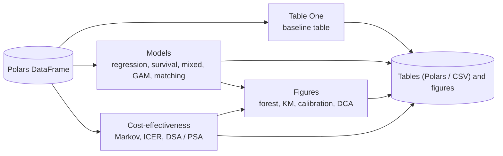

<p align="center" markdown>
  { width="360" }
</p>

# statract

A Python library for clinical research: analyze your data and make the tables and figures for your paper. Data go in as Polars data frames.



## What it does

| Area | What you can do | Main entry points |
|------|-----------------|-------------------|
| [Table One](tableone/overview.md) | Baseline tables, summaries, tests between groups | `tableone` |
| [Models](models/overview.md) | Linear and generalized linear models, Cox / AFT / Fine–Gray, mixed models, GAM, trees, matching, evaluation of prediction models | `fit_ols`, `fit_glm`, `cox_ph`, `fit_mixed`, `match_sample` |
| [Figures](viz/overview.md) | Forest plots, Kaplan–Meier curves, calibration, decision curves, funnel plots | `plot_forest`, `plot_survival` |
| [Cost-effectiveness](cea/overview.md) | Cohort Markov models, ICER, DSA / PSA | `simulate_cohort_markov`, `calculate_icers` |

## Requirements

statract needs **Python 3.13 or later**. It is not on PyPI; install it from GitHub.

```bash
pip install "git+https://github.com/mizuy/statract"
```

This installs:

| Library | Used for |
|---------|----------|
| [Polars](https://pola.rs/) | Input data and result tables |
| [NumPy](https://numpy.org/) | Numerical core |
| [SciPy](https://scipy.org/) | Distributions, tests, optimization |
| [Numba](https://numba.pydata.org/) | Fast inner loops in survival, matching and regression |
| [lme-python](https://pypi.org/project/lme-python/) | Linear and generalized linear mixed models (default engine of `fit_mixed`) |
| [Matplotlib](https://matplotlib.org/) | Forest, Kaplan–Meier, calibration and other figures |
| [japanize-matplotlib](https://pypi.org/project/japanize-matplotlib/) | Japanese fonts in figures (also uses `setuptools` on Python 3.12 and later) |
| [Plotly](https://plotly.com/python/) | Interactive helper figures |
| [Pillow](https://python-pillow.org/) | Joining Plotly figures into one image |
| [great_tables](https://posit-dev.github.io/great-tables/) | Displaying Table One |

Extras, installed only when you need them:

| Extra | Installs | Used for |
|-------|----------|----------|
| `statract[r]` | rpy2, rpy2-arrow | The R bridge `statract.r`. Install R and the R packages you use separately |
| `statract[gpboost]` | gpboost, pandas | The experimental `glmm_gpboost` |

```bash
pip install "statract[r] @ git+https://github.com/mizuy/statract"
```

pandas, statsmodels, lifelines and R are not used by default. `import statract` alone loads neither R nor rpy2.

## A minimal example

```python
import polars as pl
from statract import cox_ph, fit_ols, survival_curve

frame = pl.DataFrame(
    {
        "y": [1.2, 0.4, 2.1],
        "x": [0.0, 0.5, 1.0],
        "time": [0.4, 1.2, 0.8],
        "event": [1, 0, 1],
    }
)
fit_ols(frame, "y", ["x"])
survival_curve(frame, "time", "event")
cox_ph(frame, "Surv(time, event) ~ x")
```

## Where to start

| Goal | Page |
|------|------|
| Choose a method | [Choosing a method](guide/methods.md) |
| Run regression or survival models | [Models](models/overview.md) (with a quickstart); formulas in [Wilkinson formula](models/formula.md) |
| Make figures for a paper | [Figures](viz/overview.md) |
| Run a cost-effectiveness analysis | [Cost-effectiveness](cea/overview.md) (with a quickstart) |
| See worked examples from data to figures | [Example gallery](examples/index.md) |
| Compare numbers and speed with R | [Models vs R](models/vs-r.md), [Benchmarks](models/benchmarks.md) |
| Look up function arguments | [API](api/models/fit.md) |
| Learn the statistics behind clinical research (in Japanese) | [Learn](learn/index.md) |

## Design

- The core does not use pandas. Data and result tables are Polars. Kaplan–Meier is the built-in `survival_curve`, not lifelines.
- Output directories and CSV companions of analysis pipelines are handled by `statract.report.artifacts` and `statract.report.task_io`.

```python
from statract.report.task_io import prepare_task_output, save_frames
```
