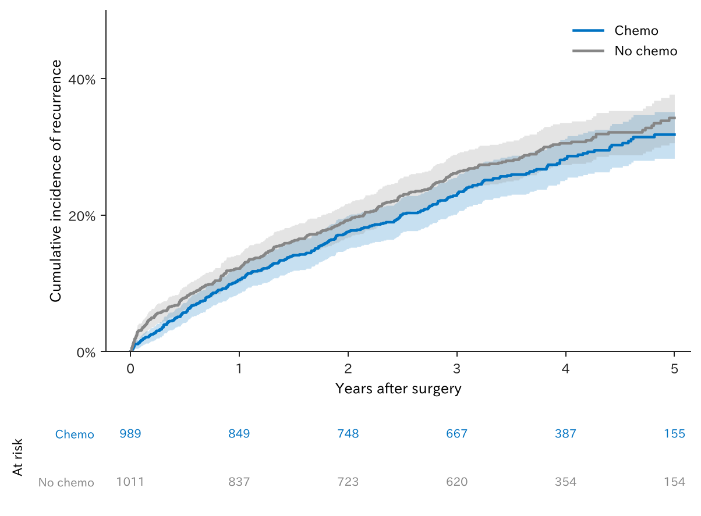
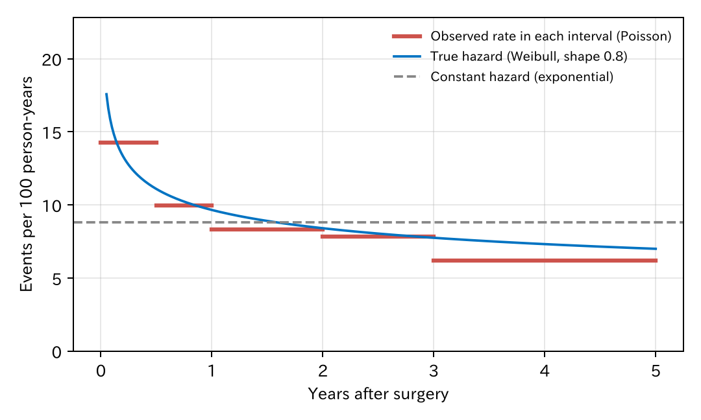
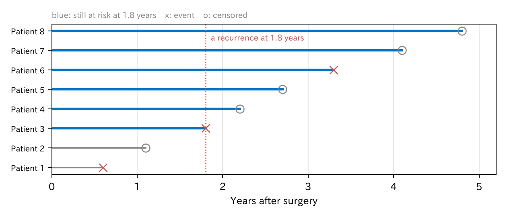
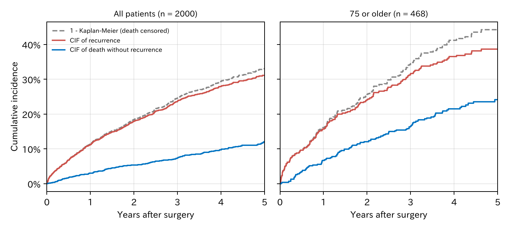

# 16. 生存時間解析

これまでのアウトカムは「出血したか、しなかったか」でした。しかし臨床では、**いつ**起きたかも大切です。がんの手術のあとの再発は、はじめの 1–2 年に多く、年がたつほど減ります。また、途中で通院しなくなった患者は、その後に再発したかどうかがわかりません。この章では、時間とともに起きる出来事を扱う**生存時間解析**（survival analysis）を紹介します。名前に「生存」とありますが、死亡に限らず、再発、出血、再入院など、どんな出来事にも使えます。

第 V 部では、章ごとにアウトカムに合った例を使います。この章の例は、**大腸がんの手術のあとの再発**です。

中心になるのは Cox 比例ハザードモデルですが、ほかに Poisson 回帰による人年法と、加速故障時間モデルも紹介し、三つの違いを考えます。

[← 目次](index.md) · [← 第 15 章](15_hierarchical.md)

## 16.1 打ち切りのあるデータ {#censoring}

ステージ II–III の結腸がんで根治手術を受けた 2000 人を、**手術から再発までの年数**で、5 年まで追跡したとします。治療として注目するのは、手術のあとの**術後補助化学療法**です。データはシミュレーションで作りました（作り方は 16.5 で種明かしします）。コードは [`examples/theory_bleeding/survival.py`](https://github.com/mizuy/statract/blob/main/examples/theory_bleeding/survival.py) にあります。

| 人数 | 再発 | 再発の前の死亡 | 5 年より前に追跡が途切れた人 | 再発までの年数（中央値） | 2 年以内の再発 |
|------|------|-------------|--------------------------|--------------------|-------------|
| 2000 | 554 | 199 | 938 | 1.4 年 | 353 人 |

[CSV](../examples/assets/theory_bleeding/ch15_summary.csv)

再発しなかった人については、「**少なくともその時点までは再発しなかった**」ことしかわかりません。5 年まで見た人も、2 年で来なくなった人も同じです。これを**打ち切り**（censoring）と呼びます。この研究では、患者の登録が 3 年にわたり、最初の登録から 6 年で研究を締め切りました。そのため遅く登録した人は 3–5 年しか見られていません。打ち切りの多くは、この**研究の締め切り**によるものです。

再発の前に亡くなった人も、その後に再発したかどうかは観察できません。16.9 までは、再発の前の死亡も打ち切りとして扱います。これで良いかどうかは、16.10 の競合リスクで考え直します。

打ち切りを無視して「再発したか」をロジスティック回帰で分析すると、2 年しか見ていない人と 5 年見た人を同じに扱うことになります。生存時間解析は、一人ひとりが**何年間見られていたか**を使って、この問題を解決します。

!!! note "打ち切りの仮定"
    生存時間解析は、打ち切られた人が、打ち切られなかった人と同じように再発しやすい（**情報のない打ち切り**）と仮定します。研究の締め切りによる打ち切りは、この仮定を満たしやすいです。一方、体調が悪くなって別の病院に移った人が多いと、この仮定がくずれます。

## 16.2 Kaplan–Meier 法 {#kaplan-meier}

**Kaplan–Meier 法**は、打ち切りを考慮して「ある時点までに再発していない割合」（生存曲線）を推定します。再発が起きた時点ごとに、その時点まで見られていた人のうち再発した人の割合を計算し、それをつないでいきます。下の図は、1 から引いた**累積発生割合**（競合リスクがないとき）です。

=== "図"

    

=== "コード"

    ```python
    from statract import plot_survival

    plot_survival(df, time="time", status="event", hue="chemo", cdf=True)   # cdf=True で累積発生割合
    ```

化学療法を受けた群のほうが、再発が少し少なく見えますが、差は小さいです。第 2 章（2.4）で見た**適応による交絡**です。化学療法は、再発しやすいステージ III の 75% に行われ、ステージ II では 23% でした。再発しやすい人ほど化学療法を受けているので、本当の効果が見えにくくなっています。比べるには背景の調整が必要です（16.5）。

打ち切りを無視するとどうなるかを、例として作った小さなデータ（200 人、5 年までに本当は 30% が再発）で見てみます。追跡が途切れる人を増やすと、再発の数を全員で割った割合は小さすぎ、打ち切られた人を除いて割った割合は大きすぎる値になります。Kaplan–Meier 法は、打ち切りが多くても、打ち切りがなかった場合の割合の近くにとどまります。

<div class="sx-widget" data-widget="km-censoring">この図を動かすには JavaScript が必要です。</div>

## 16.3 ハザードと人年法 {#hazard}

**ハザード**（hazard）は、「その時点までまだ再発していない人が、次の短い時間に再発する割合」です。単位は「1 人 1 年あたり」で、**率**（rate）の一種です。

率を一番簡単に求めるのが**人年法**（person-time method）です。再発の数を、全員が見られていた年数の合計（**人年**、短い追跡なら人日）で割ります。

| 術後補助化学療法 | 再発 | 人年 | 100 人年あたりの再発 |
|--------------|------|------|------------------|
| なし | 287 | 3074 | 9.3 |
| あり | 267 | 3206 | 8.3 |

[CSV](../examples/assets/theory_bleeding/ch15_rates.csv)

この割り算自体には、仮定は要りません。得られるのは、追跡期間全体での平均の**発生率**です。この率を、どの時点でも同じ一つのハザードとして読むときに、ハザードが追跡期間を通じて**一定**だという仮定が要ります。追跡期間を区切って、区間ごとに率を計算すると、この仮定を確かめられます。



[CSV](../examples/assets/theory_bleeding/ch15_piecewise.csv)

手術から半年までは 100 人年あたり 14 件、3 年以降は 6 件で、ハザードは時間とともに下がっています。全期間で一定とみなす（灰色の破線）と、はじめの 1 年を低く、3 年以降を高く見積もります。

## 16.4 Poisson 回帰 {#poisson}

人年法を回帰モデルにしたものが **Poisson 回帰**です。第 13 章の一般化線形モデル（generalized linear model、GLM）で、分布を Poisson にしたものにあたります。再発の数 $D$ が、率 × 人年を平均とする Poisson 分布（[数学補 A7](math/A7_distributions.md#poisson)）に従い、率の対数が線形予測子になる、と考えます。

$$
\begin{aligned}
D_i &\sim \mathrm{Poisson}(\mu_i), \qquad \mu_i = \text{率}_i \times \text{人年}_i \\
\log \mu_i &= \log(\text{人年}_i) + \beta_0 + \beta_1 x_{i1} + \cdots
\end{aligned}
$$

$\log(\text{人年})$ は係数を 1 に固定した項（**offset**、第 14 章）です。$e^{\beta_1}$ は**率比**で、ハザードが一定なら**ハザード比**と同じです。

ハザードが一定でないときは、追跡期間を区間に分け、患者ごと・区間ごとに 1 行を作ります。区間を変数として入れると、区間ごとに違うベースラインの率を持たせられます（**区分指数モデル**、piecewise exponential model）。

率比とハザード比は、一般には同じものではありません。16.3 の表のような全期間の率は、その群の人年がどの時期に多いかで重みをつけたハザードの平均です。ハザードが時間で変わり、二つの群で追跡の時期の分布が違えば、比例ハザードが成り立っていても、率の比はハザード比からずれます。一致するのは、区分指数モデルのように「区間の中ではハザードが一定」「変数の効果はどの区間でも同じ倍率（比例ハザード）」と仮定したときです。このとき Poisson 回帰の率比は、そのモデルのハザード比そのものです [@Laird1981-wm]。

=== "コード"

    ```python
    from statract import fit_glm

    # split: 患者 × 区間（0–0.5、0.5–1、1–2、2–3、3–5 年）ごとに 1 行。
    # years はその区間で見られていた年数、event はその区間で再発したか。
    fit = fit_glm(
        split,
        "event ~ interval + age + male + stage3 + t4 + cea_high + right + chemo",
        family="poisson",
        offset="log_years",   # log(years) の列
    )
    ```

Poisson 回帰は、登録データのように「区間ごとの再発数と人年」の集計表しかないときにも使えます。時間の効果を、区間やスプラインとして直接モデルに書けるのも利点です。

## 16.5 Cox 比例ハザードモデル {#cox}

臨床研究で最もよく使われるのが、**Cox 比例ハザードモデル**です [@Cox1972-qx]。

$$
h(t \mid x) = h_0(t) \times \exp(\beta_1 x_1 + \beta_2 x_2 + \cdots)
$$

- $h_0(t)$ は**ベースラインハザード**で、全部の変数が 0 の人のハザードの、時間による変化です。
- $\exp(\beta_1)$ は**ハザード比**（hazard ratio、HR）です。どの時点でも、$x_1$ が 1 増えるとハザードが $\exp(\beta_1)$ 倍になります。この「どの時点でも同じ倍率」が**比例ハザード**の仮定です。

=== "コード"

    ```python
    from statract import cox_ph, proportional_hazards_test

    fit = cox_ph(df, "Surv(time, event) ~ age + male + stage3 + t4 + cea_high + right + chemo")
    fit.tidy(exponentiate=True)        # ハザード比
    proportional_hazards_test(fit)     # 比例ハザードの検定（R の cox.zph）
    ```

| 変数 | ハザード比 | 95% 信頼区間 |
|------|----------|-----------|
| 年齢（1 歳あたり） | 1.032 | 1.02–1.04 |
| 男性 | 1.17 | 0.99–1.38 |
| ステージ III（II に比べて） | 2.17 | 1.77–2.65 |
| T4（壁を越えた浸潤） | 1.84 | 1.50–2.25 |
| 術前の CEA（がん胎児性抗原）高値 | 1.34 | 1.12–1.59 |
| 右側の結腸 | 0.93 | 0.78–1.10 |
| 術後補助化学療法 | 0.66 | 0.54–0.80 |

[CSV](../examples/assets/theory_bleeding/ch15_cox.csv) · [比例ハザードの検定 CSV](../examples/assets/theory_bleeding/ch15_ph_test.csv)

種明かしをします。このデータは、再発のハザードを、ベースラインハザードが形 0.8 の Weibull 分布の比例ハザードモデルにして作りました。この分布のハザードは、はじめが高く、だんだん下がります（[数学補 A7](math/A7_distributions.md#exponential-weibull)）。16.3 の図の青い曲線が、その本当のハザードです。比例ハザードの仮定は本当に成り立っており、検定でも全体の $P = 0.37$ でした。再発の前の死亡は、年齢とともに上がる一定のハザードで、再発とは無関係に起こるようにしました。化学療法は死亡には効きません。

statract で比例ハザードを検定する通しの例は、[生存曲線と Cox 回帰（colon）](../examples/surv_colon.md)（仮定が保たれる例）と [比例ハザードの検定と加速故障時間モデル（rotterdam）](../examples/aft_rotterdam.md)（仮定が崩れる例）にあります。

本当の化学療法のハザード比は、ステージ II で 0.90（$e^{-0.1}$）、ステージ III で 0.64（$e^{-0.45}$）です。表の 0.66 は、一つの係数でこの二つを平均したような値です。化学療法を受けた人の多くはステージ III なので、ステージ III の値に近くなっています。ほかの変数の本当のハザード比は、年齢 1.030、男性 1.11、T4 2.01、CEA 高値 1.49、右側 1.00 で、どれも推定の信頼区間に入っていました。

下の図で、ベースラインハザードの形とハザード比を動かしてみます。はじめは、この章のデータと同じ形 0.8 の Weibull 分布と、表の化学療法のハザード比 0.66 です。ハザードを 0 からその日まで足したものを**累積ハザード** $H(t)$ と呼び、生存曲線は $S(t) = e^{-H(t)}$ です。比例ハザードなら、年数の対数に対して $\log H(t)$ を描いた二本の線は平行で、幅はどこでも $\log$ ハザード比です。効果が時間とともに弱まると、平行でなくなります。

<div class="sx-widget" data-widget="hazard-survival">この図を動かすには JavaScript が必要です。</div>

### セミパラメトリックの意味 {#semiparametric}

Cox モデルは**セミパラメトリック**（semi-parametric、半パラメトリック）なモデルと呼ばれます。

- 変数の効果 $\exp(\beta x)$ は、係数という有限個のパラメータで決まります（**パラメトリック**な部分）。
- ベースラインハザード $h_0(t)$ には、形の仮定を何も置きません。一定でも、下がっても、上がって下がってもかまいません（**ノンパラメトリック**な部分）。

この二つを合わせたものなので「セミ」です。16.3 で見たように、再発のハザードは時間とともに変わります。Cox モデルはその形を知らなくても、ハザード比を推定できます。これが Cox モデルが広く使われる最大の理由です。

## 16.6 なぜ普通の最尤法が使えないのか：部分尤度 {#partial-likelihood}

第 14 章の最尤法をそのまま使おうとすると、困ったことが起きます。打ち切りのあるデータの尤度は、再発した人はその時点のハザード × その時点まで再発しない確率、打ち切られた人はその時点まで再発しない確率を掛けたものです。

$$
L = \prod_{i} h(t_i \mid x_i)^{d_i} \, S(t_i \mid x_i)
$$

$d_i$ は再発なら 1、打ち切りなら 0、$S$ は生存関数です。ここで $h_0(t)$ の形を決めないと、尤度は**関数** $h_0(t)$ に依存します。関数は、無数の値（どの時点の値も自由）を持つパラメータです。

- 第 14 章の最尤法の理論（標準誤差は曲がり具合から、例数が多いと正規分布に近づく）は、パラメータの数が**有限で決まっている**ことを前提にしています。パラメータがデータとともにいくらでも増える場合には、そのまま使えません。
- 実際、$h_0(t)$ を自由にすると、再発が起きた瞬間にだけ無限に高いハザードを置けば、尤度はいくらでも大きくできてしまいます。

そこで、$h_0(t)$ ではなく、それを積み上げた**累積ベースラインハザード** $H_0(t)$（16.5 の累積ハザードの、全部の変数が 0 の人の値）を考えます。$H_0(t)$ を、再発が起きた時点 $t_j$ にだけ高さ $\Delta H_0(t_j)$ で跳ねる階段状の関数に限ります。すると、再発した人の「その時点のハザード」は $\Delta H_0(t_j)\, e^{\eta}$、その時点まで再発しない確率は $\exp\{-H_0(t)\, e^{\eta}\}$ になり、尤度は有限になります。同じ時点に再発した人がいない（同順位、ties がない）とします。このとき跳ねの高さについて最大にすると $\Delta H_0(t_j) = 1 / \sum_{k \in R(t_j)} e^{\eta_k}$ となります（$R(t_j)$ は下で説明するリスク集合）。これを戻したプロファイル尤度（第 14 章）は、定数倍を除いて下の部分尤度と同じになります [@Johansen1983-nc]。部分尤度は、結局は最尤法の一種とも読めます。

Cox [@Cox1972-qx; @Cox1975-wg] は、$h_0(t)$ を**消してしまう**尤度を考えました。再発が起きた時点ごとに、「その時点でまだ見られていた人（**リスク集合**）のうち、再発したのがまさにその人だった確率」を考えます。



図では、1.8 年目に患者 3 が再発しました。その時点でまだリスクがあったのは、患者 3–8 の 6 人です（青）。「この 6 人のうち再発したのが患者 3 である確率」は、

$$
\frac{h_0(1.8)\, e^{\eta_3}}{\sum_{k=3}^{8} h_0(1.8)\, e^{\eta_k}} = \frac{e^{\eta_3}}{\sum_{k=3}^{8} e^{\eta_k}}
$$

で、**$h_0(1.8)$ が分子と分母で打ち消し合います**。$\eta_k$ は患者 $k$ の線形予測子です。これを再発が起きた全ての時点について掛けたものが**部分尤度**（partial likelihood）です。

$$
L_{\text{partial}}(\beta) = \prod_{\text{再発した人 } j} \frac{e^{\eta_j}}{\sum_{k \in R(t_j)} e^{\eta_k}}
$$

$R(t_j)$ は $t_j$ のリスク集合です。部分尤度は係数 $\beta$ だけの関数なので、普通の尤度と同じようにニュートン法で最大にし、曲がり具合から標準誤差を出せます。Cox は、これが普通の尤度と同じように扱えると論じました [@Cox1975-wg]。のちに Andersen と Gill [@Andersen1982-ou] が、計数過程の理論で厳密に証明しています。累積ベースラインハザード $H_0(t)$ は、$\beta$ を推定したあとで、上の跳ねの高さに推定した $\beta$ を入れて積み上げて求めます（Breslow 推定量）。

ここまでは、同じ時点に再発した人がいない場合の話です。同じ日に複数の人が再発すると（ties）、その時点の確率の書き方に近似が必要になります。近似には Breslow 法と、より正確な Efron 法があります [@Therneau2000-book]。statract の `cox_ph` は R と同じく Efron 法が既定です。この章のデータは年数を連続の値として作ったので、同順位は起きません。実際の研究では、再発は検査の日にわかるので、同順位がよく起きます。

### 時間の順番しか使わない {#ranks}

部分尤度には、再発の**時点そのもの**は出てきません。使うのは「誰がどの順番で再発し、その時に誰がまだリスクにあったか」だけです。それを確かめるため、時間を別の値に置きかえて Cox モデルを当てはめました。

| モデル | 化学療法のハザード比 | 95% 信頼区間 |
|--------|------------------|-----------|
| Cox（年数） | 0.657 | 0.54–0.80 |
| Cox（年数を順位に置きかえ） | 0.657 | 0.54–0.80 |
| Cox（年数を 2 乗） | 0.657 | 0.54–0.80 |

順番が変わらない置きかえなら、結果はまったく同じです。Cox モデルが時間の目盛りに何の仮定も置いていない、ということです。

### Poisson 回帰とのつながり {#cox-poisson}

16.4 の区分指数モデルで区間を細かくしていき、**再発が起きた時点ごとに**区切ったとします。すると、Poisson 回帰の係数は Cox モデルの係数と一致します [@Whitehead1980-xr; @Laird1981-wm]。区間ごとのベースラインの率 × 区間の長さが、Cox の $H_0(t)$ の跳ねの高さにあたります。Cox モデルは「無数の区間を持つ Poisson 回帰」と見ることもできます。

## 16.7 加速故障時間モデル {#aft}

もう一つの考え方は、ハザードではなく**時間そのもの**をモデルにすることです。**加速故障時間モデル**（accelerated failure time model、AFT モデル）は、時間の対数を線形予測子と誤差で表します [@Wei1992-hb]。

$$
\log T_i = \beta_0 + \beta_1 x_{i1} + \cdots + \sigma \varepsilon_i
$$

$\exp(\beta_1)$ は**時間比**（time ratio）で、「$x_1$ が 1 増えると、再発までの時間が $\exp(\beta_1)$ 倍に延びる（縮む）」と読みます。時計の進み方を速めたり遅めたりするイメージです。

誤差 $\varepsilon$ の分布を決めるので、AFT モデルは**完全にパラメトリック**なモデルです。パラメータの数は有限なので、16.6 の尤度をそのまま最大にする、普通の最尤法が使えます。

| 誤差の分布 | 時間 $T$ の分布 | ハザードの形 |
|-----------|---------------|------------|
| 極値分布 | Weibull | 単調に上がる、一定、または下がる。**比例ハザードでもある** |
| 極値分布で $\sigma = 1$ | 指数 | 一定（人年法と同じ） |
| 正規分布 | 対数正規 | 上がってから下がる。比例ハザードではない |

=== "コード"

    ```python
    from statract import accelerated_failure

    formula = "Surv(time, event) ~ age + male + stage3 + t4 + cea_high + right + chemo"
    weibull = accelerated_failure(df, formula, distribution="weibull")
    lognormal = accelerated_failure(df, formula, distribution="lognormal")
    weibull.tidy(exponentiate=True)   # 時間比
    ```

Weibull モデルは、AFT モデルでもあり比例ハザードモデルでもある、ただ一つの分布です。ハザード比は $\exp(-\beta / \sigma)$ で求まります。形のパラメータは $1/\sigma$ で、このデータでは 0.78 と推定されました（本当は 0.8）。

statract での AFT モデルの通しの例は、[比例ハザードの検定と加速故障時間モデル（rotterdam）](../examples/aft_rotterdam.md) にあります。比例ハザードが崩れたデータで、Weibull AFT の時間比をハザード比に直して Cox のハザード比と比べる例です。

## 16.8 モデルを比べる {#compare}

同じデータで、化学療法の効果を全部のモデルで推定しました。

| モデル | 何の比か | 化学療法 | 95% 信頼区間 |
|--------|---------|---------|-----------|
| Cox | ハザード比 | 0.66 | 0.54–0.80 |
| Poisson、ハザード一定（指数） | ハザード比 | 0.65 | 0.53–0.79 |
| Poisson、5 区間 | ハザード比 | 0.66 | 0.54–0.80 |
| Weibull（ハザード比に変換） | ハザード比 | 0.66 | 0.54–0.80 |
| Weibull AFT | 時間比 | 1.71 | 1.32–2.22 |
| 対数正規 AFT | 時間比 | 2.01 | 1.45–2.77 |
| 指数 AFT | 時間比 | 1.54 | 1.26–1.89 |

[CSV](../examples/assets/theory_bleeding/ch15_models.csv) · [対数尤度 CSV](../examples/assets/theory_bleeding/ch15_fit.csv)

- **ハザード比は、どのモデルでもほぼ同じ**です（0.65–0.66）。ハザードが一定でないのに一定とみなした Poisson でも、大きくはずれませんでした。区間で時間を扱うと Cox とほぼ一致します。本当のハザード比はステージで違う（0.90 と 0.64、16.5）ので、どのモデルも、化学療法の項が一つである限り、その平均のような値を推定しています。
- **時間比は、分布の選び方で大きく変わります**（1.54–2.01）。同じハザード比 0.66 でも、ハザードが下がっていく（形 0.78）と、「再発を 1.7 倍先に延ばす」ことになります。指数 AFT の 1.54 は、ハザード一定の Poisson のハザード比の逆数（$1/0.65$）です。
- 対数尤度は、指数 −1808.2、Weibull −1786.4、対数正規 −1798.8 でした。本当の分布である Weibull が一番良く、正しく選べています。再発が 554 人と多く、分布の形を決める情報が十分にあったからです。出来事が少なく、ほとんどが打ち切りのデータでは、分布どうしの区別がつかないことがよくあります。

時間比は「再発までの時間が延びる」と直感的に読めそうですが、この例では **5 年までに 3 人に 2 人は再発しません**。その人たちの「再発までの時間」は観察されていません。時間比は、観察していない遠い将来の分布の形に強く依存します。

## 16.9 どう使い分けるか {#choose}

| | Cox | Poisson（人年法） | AFT |
|--|-----|----------------|-----|
| 効果の指標 | ハザード比 | 率比（ハザード比） | 時間比 |
| ベースラインの仮定 | なし（セミパラメトリック） | 区間ごとに一定 | 分布を決める（パラメトリック） |
| 推定 | 部分尤度 | 普通の最尤法 | 普通の最尤法 |
| 向いている場面 | 治療や因子の効果を比べる（標準） | 集計データ、長い追跡、時間の効果を直接見たい | 時間の予測、追跡期間を超えた外挿、比例ハザードが成り立たない |

- 効果の推定には、まず Cox モデルを使い、比例ハザードを確かめます。
- 比例ハザードが成り立たないとき（効果が時間とともに弱まるなど）は、時間で層別したハザード比、制限付き平均生存時間（restricted mean survival time、RMST、statract の `restricted_mean_survival`）、AFT モデルを考えます。statract での RMST の通しの例は、[生存曲線と Cox 回帰（colon）](../examples/surv_colon.md) にあります。
- 医療経済評価のように、追跡期間の先まで生存曲線を延ばす必要があるときは、パラメトリックなモデル（Weibull、対数正規など）が必要です。ただし、16.8 のように分布の選び方で結果が大きく変わるので、いくつかの分布で比べます。
- 再発の前に死亡すると、その人はもう再発しません。このような**競合リスク**があるときは、死亡を打ち切りとして扱いません（16.10）。
- これとは別に、再発しそうな人ほど追跡から外れるような**情報のある打ち切り**は、競合リスクの方法では解決しません。打ち切りの理由を調べ、打ち切りの重み付けや感度分析を考えます。

## 16.10 競合リスク {#competing-risks}

### 打ち切りと競合の違い {#censoring-vs-competing}

打ち切りは「その後に再発したかどうかが**わからない**」ことです。Kaplan–Meier 法は、打ち切られた人も、その後は見られている人と同じ率で再発すると仮定します（16.1）。

一方、再発の前に死亡した人は、その後に再発することが**ありません**。ある出来事が起きると関心のある出来事がもう起きなくなるとき、その出来事を**競合事象**（competing event）と呼びます。ここまでのように死亡を打ち切りにして Kaplan–Meier 法で「1 − 生存曲線」を出すと、死亡した人を、生きていれば再発しえた人として扱うことになります。そのため、実際の累積発生割合より**大きく**見積もります [@Noordzij2013-pn]。

競合があるときに「ある時点までに再発した人の割合」を正しく推定するのが、**累積発生関数**（cumulative incidence function、CIF）です。推定には Aalen–Johansen 推定量を使います。考え方は Kaplan–Meier 法と同じで、各時点で「その時点までどの出来事も起きていない割合」に「その時点で再発した割合」を掛けて足していきます。こうすると、再発の CIF と死亡の CIF と「どちらも起きていない割合」の合計が、いつも 1 になります。1 − Kaplan–Meier のほうは、この合計が 1 を超えることがあります。

この章のデータでは、2000 人のうち 199 人が再発の前に亡くなりました。5 年の累積再発割合は、死亡を打ち切りにした 1 − Kaplan–Meier で 33.0%、CIF で 31.1% でした。全体では差は 2 ポイントです。しかし、再発の前の死亡が多い 75 歳以上（468 人）に限ると、1 − Kaplan–Meier は 44.3%、CIF は 38.7% で、差は 5.6 ポイントに広がります。75 歳以上では、5 年までに 24.2% が再発の前に亡くなっているからです。



[CSV](../examples/assets/theory_bleeding/ch15_cif.csv)

差が大きくなるのは、競合事象が多いとき、追跡が長いときです。高齢者の長期の再発や、がん患者の合併症のように、死亡が多い場面では、まず競合事象があるかどうかを考えます。別の例として、原発性胆汁性胆管炎（primary biliary cholangitis、PBC）の試験で、肝移植を競合として死亡を見た例があります（[競合リスク解析（PBC）](../examples/cif_pbc.md)）。

### 二つのハザード {#two-hazards}

競合リスクで回帰モデルを使うときは、二つのハザードを区別します [@Austin2016-dj; @Wolbers2014-iu]。

- **原因別ハザード**（cause-specific hazard）：まだどの出来事も起きていない人が、次に再発する率。死亡した人はその時点でリスク集合から外します。推定は、死亡を打ち切りにした普通の Cox モデルで構いません。16.5 の Cox モデルは、実はこの原因別ハザードのモデルでした。ハザードの定義そのものは正しく、まちがっているのは、それを 1 − Kaplan–Meier で割合に直すところだけです。
- **部分分布ハザード**（subdistribution hazard）：まだ再発していない人が、次に再発する率。ここでは、すでに死亡した人もリスク集合に残します。CIF と一対一に対応するので、部分分布ハザード比が 1 より大きければ、CIF も大きくなります。この比例ハザードを仮定した回帰が **Fine–Gray モデル**です [@Fine1999-kj]。

二つは答える問いが違います。

| | 原因別ハザード（Cox） | 部分分布ハザード（Fine–Gray） |
|--|------|------|
| リスク集合 | どの出来事もまだ起きていない人 | 関心のある出来事がまだ起きていない人（競合で死亡した人も残す） |
| 効果の指標 | 原因別ハザード比 | 部分分布ハザード比（subdistribution hazard ratio、SHR） |
| 向いている問い | 病因：その因子は再発の起こりやすさそのものを変えるか | 予測、予後：その因子のある人で、実際に再発する人の割合は増えるか |

二つの答えは食い違うことがあります。たとえば、ある因子が死亡を大きく増やすと、再発の原因別ハザードが変わらなくても、再発する前に亡くなる人が増えるので、再発の CIF は下がり、SHR は 1 より小さくなります。このため、どちらか一方だけで「その因子は再発を減らす」と読むのは危険です。

この章のデータで、三つのモデルを比べました。

| 変数 | 再発の原因別ハザード比 | 死亡の原因別ハザード比 | 再発の SHR（Fine–Gray） |
|------|------------------|------------------|-------------------|
| 年齢（1 歳あたり） | 1.032（1.02–1.04） | 1.094（1.08–1.11） | 1.025（1.02–1.03） |
| 術後補助化学療法 | 0.66（0.54–0.80） | 0.99（0.70–1.40） | 0.66（0.54–0.80） |

[CSV](../examples/assets/theory_bleeding/ch15_competing.csv)

年齢は、再発のハザードを 1 歳あたり 3% 上げ、再発の前の死亡のハザードを 9% 上げます。高齢の人は再発しやすい一方で、再発する前に亡くなる人も多いので、SHR（1.025）は原因別ハザード比（1.032）より小さくなります。化学療法は死亡に効かないので、二つの比はほぼ同じです。関心のある出来事だけでなく、競合事象の解析も一緒に示すことが勧められています [@Austin2016-dj; @Austin2017-po]。

### SHR の読み方 {#shr}

SHR は「CIF の大小」を表す量としては読みやすいのですが、ハザード比としては読みにくい量です。リスク集合に死亡した人が残っているので、「まだ生きていて再発していない人の中で、再発する率が何倍か」とは読めません。報告では、SHR だけでなく、群ごとの CIF の曲線と、決めた時点での CIF の値（たとえば 5 年で何 %）を示します [@Austin2017-po]。群間の CIF の差を検定するときは Gray 検定を使います [@Gray1988-ku]。

statract では、群ごとの CIF は `survival_curve(..., kind="aalen_johansen")` か `cumulative_incidence`、Fine–Gray モデルは `fine_gray_regression` で推定します。原因別ハザードは、競合事象を打ち切りにした `cox_ph` です。

```python
from statract import cox_ph, cumulative_incidence, fine_gray_regression

# cause：0 = 打ち切り、1 = 再発、2 = 再発の前の死亡
rhs = "age + male + stage3 + t4 + cea_high + right + chemo"
cumulative_incidence(df, "time", "cause").at([1, 3, 5])         # CIF
cox_ph(df, f"Surv(time, recurrence) ~ {rhs}")                   # 原因別ハザード（死亡は打ち切り）
fine_gray_regression(df, f"Surv(time, cause) ~ {rhs}", cause=1)  # 部分分布ハザード
```

通しの例は [競合リスク解析（PBC）](../examples/cif_pbc.md) にもあります。

## 文献 {#references}

教科書では、Collett [@Collett2023-book] が入門に、Therneau と Grambsch [@Therneau2000-book] が Cox モデルの拡張と診断に向いています。Collett は第 2 版の日本語訳 [@Collett2013-book-ja] があります。日本語で書かれた教科書では、大橋ら [@Ohashi2022-book] が Kaplan–Meier 法から Cox 回帰までを SAS の例とともに説明しています。Cox モデルに絞った本では、中村 [@Nakamura2018-book] が比例ハザード性の確かめ方、モデルが合わないときの対策、競合リスクを扱っています。

::: {#refs}
:::

## まとめ

- 生存時間のデータには打ち切りがあります。生存時間解析は、一人ひとりが見られていた時間を使います。
- ハザードは「まだ起きていない人が次に起きる率」です。人年法は、出来事の数を人年で割って、平均の発生率を出します。この率を一つのハザードとして読むときは、ハザードが一定だと仮定しています。
- Poisson 回帰は人年法の回帰版です。区間に分ければ、時間とともに変わるハザードも扱えます。
- Cox モデルは、ベースラインハザードに何の仮定も置かないセミパラメトリックなモデルです。そのため普通の最尤法はそのままでは使えず、ベースラインハザードが打ち消し合う部分尤度を最大にします（再発の時点にだけ跳ねる階段状の累積ベースラインハザード $H_0$ についてのプロファイル尤度とも読めます）。使うのは時間の順番だけです。
- AFT モデルは時間そのものをモデルにする、完全にパラメトリックなモデルで、普通の最尤法が使えます。効果は時間比で、分布の選び方に強く左右されます。
- ハザード比はモデルによらず安定しています。効果の推定には Cox、集計データや時間の効果には Poisson、時間の予測や外挿には AFT が向いています。
- 競合事象（再発の前の死亡など）があるときは、それを打ち切りにした 1 − Kaplan–Meier は累積発生割合を大きく見積もります。CIF を使い、原因別ハザード（病因）と部分分布ハザード（予測）を問いに合わせて使い分けます。

**次へ：**[第 17 章 診断の指標](17_diagnostic-metrics.md)
