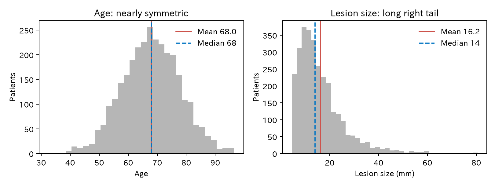

# 1. 記述：まずデータを見る

臨床の問いには、記述、予測、因果の三つがあります（[はじめに](index.md)）。この章は**記述**です。どんな患者が何人いて、出血がどのくらい起きたのかを、そのまま示します。

記述は、ほかの二つの前置きではありません。「この治療を受けた患者で、出血はどのくらい起きるか」は、それ自体が臨床の問いです。記述の問いでも、**誰について**（対象集団）、**いつの**（時点と期間）、**何を**（割合、平均など）示すのかを決めます [@Lesko2022-wi]。

[← 目次](index.md)

## 1.1 例のデータ {#data}

大腸の内視鏡的切除を受けた患者のデータです。知りたいのは**遅発性出血**（切除後、数日以内の出血）です。

--8<-- "examples/assets/theory_bleeding/n.md"

| 列 | 意味 |
|----|------|
| `age` | 年齢（歳） |
| `male` | 男性なら 1 |
| `antithrombotic` | 抗血栓薬を飲んでいれば 1 |
| `hypertension` | 高血圧があれば 1 |
| `size_mm` | 病変径（mm） |
| `proximal` | 近位結腸（盲腸–横行結腸）なら 1 |
| `clip` | 予防的クリップで閉鎖したら 1 |
| `bleed` | 遅発性出血があれば 1 |

!!! warning "シミュレーションデータです"
    この数字は実在の患者ではありません。どの変数がどの変数に影響するかを決めて、乱数で作りました。本当の構造は [第 2 章](independent-risk-factor.md#dag) で見せます。実際の研究では、この構造は誰にもわかりません。

## 1.2 Table 1 {#table1}

論文の最初の表（Table 1）は、対象集団の記述です。全員を一列にまとめます。

=== "表"

    --8<-- "examples/assets/theory_bleeding/ch0_table1_gt.md"

    [CSV](../examples/assets/theory_bleeding/ch0_table1.csv)

=== "コード"

    ```python
    from statract import agg_category, agg_mean_sd, agg_median_iqr, write_tableone_artifacts

    params = {
        "Age": ("age", agg_mean_sd),
        "Male": ("male_label", agg_category),
        "Antithrombotic": ("antithrombotic_label", agg_category),
        "Hypertension": ("hypertension_label", agg_category),
        "Lesion size (mm)": ("size_mm", agg_median_iqr),
        "Proximal colon": ("proximal_label", agg_category),
        "Prophylactic clip": ("clip_label", agg_category),
        "Delayed bleeding": ("bleed_label", agg_category),
    }
    write_tableone_artifacts(out, "ch0_table1", df=shown, params=params)
    ```

年齢の平均は 68.0 歳で、抗血栓薬は 5 人に 1 人、クリップは 3 人に 1 人が使っています。この表から「誰に当てはまる結果か」がわかります。たとえば、抗血栓薬を飲む人が 1 割しかいない施設では、この結果をそのまま使えないかもしれません。

表に欠測値の数も示します。このデータには欠測がありませんが、実際の研究では変数ごとに何人分が欠けているかを書きます。

## 1.3 割合と信頼区間 {#proportion}

遅発性出血は 3000 例中 136 例、**4.5%** でした。この割合には、偶然によるばらつきがあります。同じ条件の患者をもう一度 3000 人集めれば、少し違う値になるはずです。そのばらつきの幅を **95% 信頼区間**（confidence interval、CI）で示します。

| 集団 | 例数 | 出血 | 割合 | 95% CI |
|------|------|------|------|--------|
| 全体 | 3000 | 136 | 4.5% | 3.8–5.3% |
| クリップあり | 927 | 47 | 5.1% | 3.8–6.7% |
| クリップなし | 2073 | 89 | 4.3% | 3.5–5.3% |

[CSV](../examples/assets/theory_bleeding/ch0_rates.csv)

```python
from statract import proportion_ci

df.select(proportion_ci(pl.col("bleed"), method="wilson"))
```

信頼区間には Wilson 法を使いました。教科書によく載る「割合 ± 1.96 × 標準誤差」（Wald 法）は、例数が少ないときや割合が 0% や 100% に近いときに、幅が狭すぎたり 0% を下回ったりします。Wilson 法はその心配が少ない方法です。

!!! note "記述として正しく、因果としては読めない"
    クリップを使った患者のほうが、出血が少し多く見えます（5.1% 対 4.3%）。これは記述としては正しい数字です。しかし「クリップは出血を増やす」とは読めません。クリップは、大きな病変や抗血栓薬を飲む人など、もともと出血しやすい患者に使われているからです。この点は [第 2 章](independent-risk-factor.md) と [第 3 章](causal-basics.md) で扱います。

## 1.4 平均か中央値か {#center}

連続の変数は、分布の形に合わせて要約します。

=== "図"

    

    [CSV](../examples/assets/theory_bleeding/ch0_summary.csv)

=== "コード"

    ```python
    import numpy as np

    for col in ["age", "size_mm"]:
        x = df[col].to_numpy()
        q1, med, q3 = np.percentile(x, [25, 50, 75])
        print(col, x.mean(), x.std(ddof=1), med, q1, q3)
    ```

| 変数 | 平均（標準偏差） | 中央値（四分位範囲） | 最小–最大 |
|------|------------------|----------------------|-----------|
| 年齢（歳） | 68.0（9.9） | 68（61–75） | 33–95 |
| 病変径（mm） | 16.2（9.7） | 14（10–20） | 5–80 |

- 年齢は左右ほぼ対称です。平均と中央値がほぼ同じなので、平均（標準偏差）で示します。
- 病変径は右に長く裾を引きます。少数の大きな病変に引っぱられて、平均（16.2 mm）が中央値（14 mm）より大きくなります。このようなときは中央値（四分位範囲）で示します。

標準偏差（standard deviation、SD）は個々の患者のばらつき、標準誤差（standard error、SE）は平均や割合の推定のばらつきです。Table 1 で示すのは患者のばらつきなので、標準偏差を使います。詳しくは [A4. 期待値と分散](math/expectation-variance.md) にあります。

## 1.5 P 値と信頼区間 {#p-value}

1.3 の表で、クリップありとなしの出血割合の差は 0.8 ポイント（5.1% − 4.3%）でした。この差に、$P$ 値と 95% 信頼区間をつけてみます。

```python
from statract import prop_test

prop_test([47, 89], [927, 2073], correct=False)   # 出血数と例数
```

差は 0.8 ポイント（95% CI −0.9–2.4 ポイント）、$P = 0.34$ です。

$P$ 値を計算するには、まず、データがどのように生まれたかを表す**統計モデル**を置きます。この例のモデルは、次のような前提の組です。

- 患者ごとの出血は互いに独立で、各群の出血の人数は二項分布に従う
- 患者の選び方や出血の測り方に偏りがない
- 解析の方法は、データを見る前に決めてある
- 二つの群の出血割合は等しい（**帰無仮説**）

このモデルが正しければ、二つの群の差を標準誤差で割って 2 乗した量（**検定統計量**、ここではカイ 2 乗統計量）は、自由度 1 のカイ 2 乗分布に従います。この例の検定統計量は 0.89 です。**$P$ 値**は、モデルが正しいとしたときに、検定統計量が今の値と同じか、それより大きくなる確率です。

$P = 0.34$ なら、モデルが正しくても、この程度の差は 3 回に 1 回くらい出ます。データはモデルとよく合っています。逆に $P$ が小さいときは、データがモデルと合っていません。ただし、どの前提が合っていないのかは、$P$ 値からはわかりません。帰無仮説が誤っているのかもしれませんし、ほかの前提（独立性、偏りがないこと、事前に決めた解析であること）がくずれているのかもしれません [@Greenland2016-uc]。つまり $P$ 値は、帰無仮説だけでなく、**モデル全体とデータがどのくらい合わないか**を示す目安です。

$P$ 値は、次のように読み違えられやすい数字です。

- $P$ 値は「差がない確率」ではありません。モデルが正しい確率でも、誤っている確率でもありません。モデルが正しいと仮定したうえで計算した確率です。
- $P$ 値は効果の大きさを表しません。例数が多ければ小さな差でも小さくなり、例数が少なければ大きな差でも大きくなります。
- $P > 0.05$ は「差がない」ことの証明ではありません。この例の信頼区間は、差が −0.9 ポイントから 2.4 ポイントまでのどれでも、データと矛盾しないことを示しています。
- 0.05 は慣習で決めた目安です。$P = 0.049$ と $P = 0.051$ に本質的な違いはありません。

米国統計学会（American Statistical Association、ASA）は 2016 年に、$P$ 値について次の六つの原則を示しました [@Wasserstein2016-ln]。

1. $P$ 値は、データが特定の統計モデルとどのくらい合わないかを示します。
2. $P$ 値は、仮説が正しい確率や、データが偶然だけで生じた確率ではありません。
3. 科学的な結論や臨床、政策の判断を、$P$ 値がある閾値を下回るかどうかだけで決めてはいけません。
4. 正しい推論には、行った解析をすべて報告する透明性が要ります。
5. $P$ 値や「有意」は、効果の大きさや結果の重要さを測るものではありません。
6. $P$ 値だけでは、モデルや仮説についての証拠のよい尺度になりません。

New England Journal of Medicine（NEJM）も 2019 年に統計の報告指針を改めました [@Harrington2019-mj]。比較の数が多いと、どれかが偶然で $P < 0.05$ になりやすくなります（**多重性**）。そこで、多重性の調整を事前に決めていない副次的な解析などでは、$P$ 値を示さず、効果の推定値と 95% 信頼区間だけを示します。そのとき、区間が多重性で調整されていないことを書き添えます。

NEJM の投稿規定（[Statistical Reporting Requirements](https://www.nejm.org/author-center/new-manuscripts)）は、$P$ 値の書き方も決めています。

- 0.01 より大きい $P$ 値は小数 2 桁（$P = 0.34$）
- 0.01 から 0.001 の間は小数 3 桁（$P = 0.004$）
- 0.001 より小さい $P$ 値は $P < 0.001$
- 例外は、試験を途中で止めるかどうかの判定（中止規則）に使う検定と、ゲノムワイド関連解析
- 非劣性試験のようにデザインが片側検定を求める場合を除き、$P$ 値は両側

細かい桁数を並べても、判断は変わりません。$P = 0.0000012$ のような書き方は避けます。JAMA、Lancet、BMJ の書き方との比較は [付録 C](p-value-format.md) にまとめました。

本書でも、効果は推定値と 95% 信頼区間を中心に示します。$P$ 値は添えるだけにして、0.05 で白黒をつける読み方はしません。

## 1.6 Table 1 に P 値をつけるか {#pvalue}

Table 1 を群に分けて、群の差に $P$ 値をつける論文をよく見ます。これには注意が要ります。

- ランダム化比較試験（randomized controlled trial、RCT）では、群の差は偶然でしか生じません。偶然かどうかを検定しても意味がないので、報告指針 CONSORT は Table 1 で検定しないよう勧めています [@Moher2010-cd]。報告指針は [付録 B](reporting-guidelines.md) にまとめています。
- 観察研究で治療の有無に分けるときは、群の違いの大きさを標準化差（standardized mean difference、SMD）で示します。$P$ 値は例数が多いほど小さくなり、違いの大きさを表さないからです。[第 5 章](propensity-score-matching.md) で扱います。
- 結果（出血の有無）で分けて $P$ 値をつけると、それはもう記述ではなく、一つずつの比較（単変量解析）です。[第 2 章](independent-risk-factor.md) はここから始まります。

## 文献 {#references}

日本語では、新谷 [@Shintani2024-book] が臨床家向けに、記述統計、信頼区間、検定の基礎を説明しています。

::: {#refs}
:::

## まとめ

- 記述は、対象集団、時点、示す量を決めて、データをそのまま示す問いです。
- Table 1 は「誰に当てはまる結果か」を示します。
- 割合には信頼区間をつけます。例数が少ないときは Wilson 法などを使います。
- $P$ 値は、帰無仮説を含むモデル全体とデータの合わなさの目安です。差がない確率でも、効果の大きさでもありません。効果は推定値と信頼区間で示します。
- 対称な分布は平均（標準偏差）、偏った分布は中央値（四分位範囲）で示します。
- 記述の数字は正しくても、群の差をそのまま因果として読むことはできません。

**次へ：**[第 2 章 「独立した危険因子」とは何か](independent-risk-factor.md)
