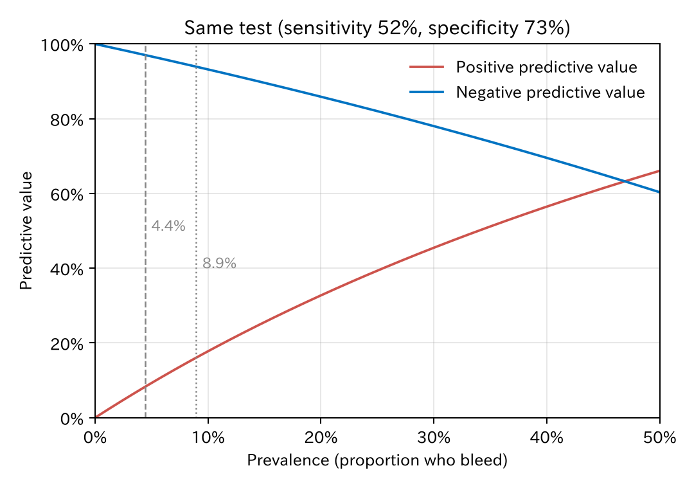
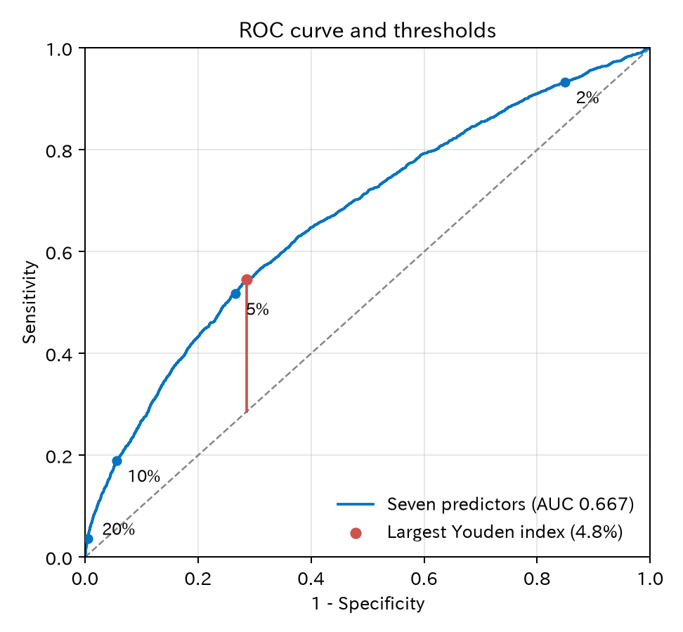
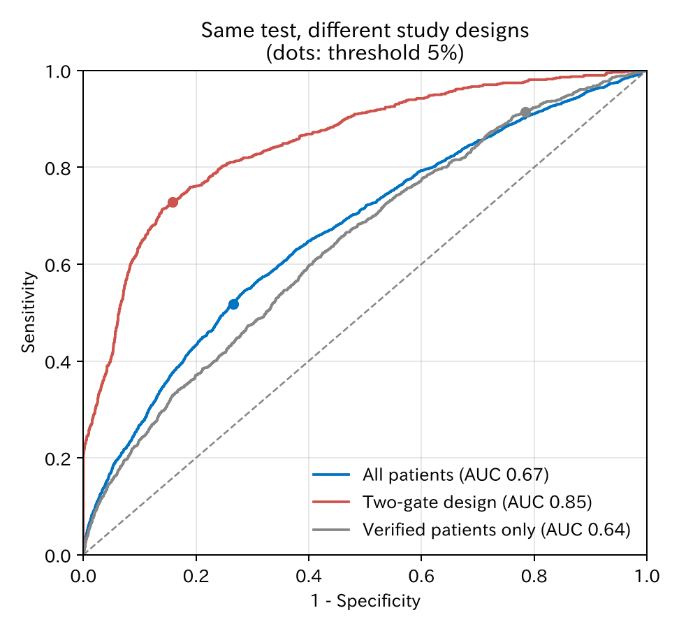

# 17. 診断の指標

検査が陽性だったとき、その患者が本当に病気である確率はどのくらいでしょうか。この章では、検査の良さを表す指標（感度、特異度、的中率、尤度比、ROC 曲線）を整理し、診断精度の研究を読むときの落とし穴を見ます。

[← 目次](index.md) · [← 第 16 章](survival.md)

例には、第 10 章のルールをそのまま「検査」として使います。第 8 章の 3000 人で作った七つの変数のモデルを、同じ仕組みで作った**新しい患者 5 万人**に当てはめ、予測確率が **5% 以上なら陽性**とします。データはシミュレーションで、出血したかどうか（参照基準）は全員でわかっています。診断の検査は「いまの病気」を、予測モデルは「これから起きること」を当てますが、陽性か陰性かを出して真の状態と比べる、という計算は同じです。

## 17.1 2×2 表、感度と特異度 {#two-by-two}

検査の結果と真の状態を、2×2 の表にまとめます。

| | 出血あり | 出血なし | 計 |
|--|---------|---------|-----|
| 陽性 | 1142（真陽性） | 12700（偽陽性） | 13842 |
| 陰性 | 1066（偽陰性） | 35092（真陰性） | 36158 |
| 計 | 2208 | 47792 | 50000 |

[CSV](../examples/assets/theory_bleeding/ch16_table.csv)

表を**縦に**読むのが感度と特異度です。

- **感度**（sensitivity）：出血する人のうち陽性になる割合。1142 / 2208 = 51.7%
- **特異度**（specificity）：出血しない人のうち陰性になる割合。35092 / 47792 = 73.4%

感度と特異度は、真の状態ごとに計算するので、出血する人の割合（有病割合、ここでは 4.4%）が変わっても、計算の上では変わりません。ただし、患者の構成が変われば変わります（17.7）。

## 17.2 陽性的中率と陰性的中率 {#predictive-values}

臨床で知りたいのは、表を**横に**読んだ値です。

- **陽性的中率**（positive predictive value、PPV）：陽性の人のうち出血する割合。1142 / 13842 = 8.3%
- **陰性的中率**（negative predictive value、NPV）：陰性の人のうち出血しない割合。35092 / 36158 = 97.1%

的中率は、感度と特異度に加えて**有病割合**で決まります。計算はベイズの定理です（[数学補 A3](math/conditional-probability.md#ppv)）。下の図は、感度と特異度を 52% と 73% に固定して、有病割合だけを変えたものです。



第 10 章の「リスクの高い病院」（出血 8.9%）で同じルールを使うと、陽性的中率は 15.4%、陰性的中率は 93.6% でした。同じ検査でも、出血の多い集団では陽性的中率が約 2 倍になり、陰性的中率が下がります。論文の的中率は、**その研究の有病割合のもとでの値**です。

## 17.3 尤度比 {#likelihood-ratio}

**尤度比**（likelihood ratio、LR）は、ある検査結果が、出血する人で出る確率と、出血しない人で出る確率の比です。

$$
\text{LR+} = \frac{\text{感度}}{1 - \text{特異度}} = \frac{0.517}{0.266} = 1.95,
\qquad
\text{LR−} = \frac{1 - \text{感度}}{\text{特異度}} = \frac{0.483}{0.734} = 0.66
$$

（第 14 章の尤度比検定と名前は似ていますが、別の量です。）

尤度比の使い道は、**オッズ**（[数学補 A2](math/odds-log.md)）で書いたベイズの定理です。

$$
\text{検査後のオッズ} = \text{検査前のオッズ} \times \text{尤度比}
$$

検査前の確率 4.4% はオッズ 0.046 です。陽性なら 0.046 × 1.95 = 0.090 で、確率に戻すと 8.3%（陽性的中率と同じ）です。陰性なら 0.046 × 0.66 = 0.030 で 2.9%（1 − 陰性的中率）です。

尤度比が 1 から離れるほど、結果で確率が大きく動きます。尤度比 10 の陽性や 0.1 の陰性は診断をほぼ決めますが、この例の 1.95 と 0.66 では、確率はあまり動きません。

下の図は Fagan のノモグラムです。左の軸（検査前の確率）と真ん中の軸（尤度比）を直線で結ぶと、右の軸で検査後の確率が読めます。検査前の確率と尤度比を動かしてみてください。

<div class="sx-widget" data-widget="fagan">この図を動かすには JavaScript が必要です。</div>

!!! note "尤度比は別の場所に持っていきやすい"
    尤度比は感度と特異度だけで決まるので、有病割合には直接よりません。論文の尤度比に**自分の患者の検査前確率**を掛ければ、検査後の確率が出ます。リスクの高い病院では、陽性的中率は 8.3% から 15.4% に変わりましたが、LR+ は 1.95 から 1.86 への変化でした。ただし完全に一定ではありません。患者の構成が違うと感度と特異度も少し変わるからです（17.7）。

陽性か陰性かの二つに分けず、結果の**区分ごと**に尤度比を出すこともできます。予測確率を四つに分けると、次のとおりでした。

| 予測確率 | 人数 | 出血する人のうちの割合 | 出血しない人のうちの割合 | 尤度比 | 実際の出血 |
|---------|------|--------------------|----------------------|-------|----------|
| 2% 未満 | 7327 | 6.7% | 15.0% | 0.45 | 2.0% |
| 2–5% | 28831 | 41.6% | 58.4% | 0.71 | 3.2% |
| 5–10% | 10750 | 32.8% | 21.0% | 1.56 | 6.7% |
| 10% 以上 | 3092 | 18.9% | 5.6% | 3.38 | 13.5% |

[CSV](../examples/assets/theory_bleeding/ch16_bands.csv)

10% 以上の区分の尤度比は 3.38 で、「5% 以上」の LR+ 1.95 よりも大きくなります。二つに分けると、この情報が失われます。

## 17.4 閾値、ROC 曲線、Youden 指数 {#threshold}

陽性とする閾値を下げると、感度が上がり、特異度が下がります。閾値ごとの（1 − 特異度、感度）をつないだものが **ROC 曲線**（receiver operating characteristic curve、受信者動作特性曲線）で、曲線の下の面積が **AUC**（area under the curve、曲線下面積）です。どちらも第 10 章で予測モデルについて説明したものと同じです（[10.1](discrimination-calibration.md#discrimination)）。AUC は 0.667（95% 信頼区間 0.654–0.679、DeLong 法）でした。

=== "図"

    

    [CSV](../examples/assets/theory_bleeding/ch16_roc_points.csv)

=== "コード"

    ```python
    import numpy as np
    from statract import roc_curve, threshold_tradeoff

    roc = roc_curve(y_new, p_full)
    roc.ci_auc()                                   # AUC と 95% 信頼区間（DeLong）
    roc.coords("best", best_method="youden")       # Youden 指数が最大の閾値
    threshold_tradeoff(y_new, p_full, thresholds=np.array([0.02, 0.05, 0.10, 0.20]))
    ```

閾値の選び方としてよく使われるのが **Youden 指数**（感度 + 特異度 − 1）です。図の赤い縦線の長さで、ROC 曲線が対角線から最も離れた点を選びます。この例では閾値 4.8%（感度 54.5%、特異度 71.4%、Youden 指数 0.26）で、5% とほとんど同じでした。

ただし、Youden 指数は「出血を見逃す 1 人」と「出血しない人を陽性にする 1 人」の重みを、それぞれの群の人数で割ってそろえただけの基準です。言いかえると、見逃しの損失を、偽陽性の損失の（1 − 有病割合）/ 有病割合 倍（ここでは約 22 倍）と置いたことになります。予測確率が当たっていれば、これは「予測確率が有病割合を超えたら陽性」という閾値にあたり、4.8% が出血割合 4.4% に近いのはそのためです。

実際の閾値は、**誤りの損失**で決めるべきです。見逃しが重大で、偽陽性の負担（追加の検査や入院）が軽ければ閾値を下げ、逆なら上げます。第 10 章の決定曲線は、この考えを「閾値 $p_t$ では、出血する 1 人を見つけるために、出血しない人を $(1 - p_t)/p_t$ 人まで陽性にしてよい」という形で表したものです（[10.4](discrimination-calibration.md#dca)）[@Vickers2006-mk]。尤度比で言えば、検査後の確率がその閾値を超えるような結果だけが、方針を変えます。

## 17.5 信頼区間 {#ci}

感度と特異度は割合なので、二項分布（[数学補 A7](math/distributions.md#binomial)）の信頼区間をつけます。ここで大切なのは、感度の精度を決めるのは**出血した人の数**だということです。

| 研究 | 出血した人 | 感度（95% 信頼区間） | 特異度（95% 信頼区間） | LR+（95% 信頼区間） |
|------|----------|-----------------|-------------------|-----------------|
| 5 万人 | 2208 | 51.7%（49.6–53.8%） | 73.4%（73.0–73.8%） | 1.95（1.86–2.03） |
| うち最初の 1000 人 | 35 | 65.7%（49.2–79.2%） | 73.1%（70.2–75.8%） | 2.44（1.88–3.17） |

[CSV](../examples/assets/theory_bleeding/ch16_table.csv)

1000 人の研究でも、出血は 35 人しかいません。感度の区間は 30 ポイントの幅があり、点推定 65.7% は 5 万人での 51.7% から大きくずれています。まれな病気では、感度を確かめるのに多くの患者が必要です。

コードでは、割合の区間に **Wilson のスコア区間**（statract の `proportion_ci(..., method="wilson")`）を使いました [@Agresti2013-book]。0% や 100% に近い割合や少ない人数でも、正規近似（Wald）の区間より信頼できます。正確な二項分布による Clopper–Pearson の区間（`binom_test`）も使われ、こちらはやや広めになります（35 人中 23 人で 47.8–80.9%）。尤度比の区間は、対数をとって正規近似する方法で計算しました。

## 17.6 二つの検査を比べる {#compare}

同じ患者に二つの検査をした場合、結果は**対応がある**（paired）ので、別々の患者の割合を比べる検定は使えません。ここでは、七つの変数のモデルと、年齢と抗血栓薬だけの簡単なモデルを、同じ 5 万人で同じ閾値 5% で比べます。

| | 七つの変数 | 年齢と抗血栓薬 | 片方だけ正しい人の数 | 検定 |
|--|----------|-------------|-----------------|------|
| 感度（出血 2208 人） | 51.7% | 35.5% | 452 対 94 | McNemar 検定 |
| 特異度（出血なし 47792 人） | 73.4% | 81.1% | 1847 対 5516 | McNemar 検定 |
| AUC | 0.667 | 0.609 | 差 0.058（0.046–0.070） | DeLong 検定（対応あり） |

[CSV](../examples/assets/theory_bleeding/ch16_compare.csv)

- **McNemar 検定**は、二つの検査の結果が**食い違った人**だけを使います [@Agresti2013-book]。出血した人のうち、七つの変数だけが陽性にした人は 452 人、簡単なモデルだけが陽性にした人は 94 人でした。感度は出血した人で、特異度は出血しなかった人で、別々に検定します。
- 同じ閾値でも、七つの変数のモデルは感度が高く、特異度が低いという結果でした。閾値一つの比較は、閾値の位置に左右されます。
- 閾値によらない比較が AUC です。同じ患者の ROC 曲線どうしは相関するので、それを考慮する **DeLong 法**で比べます（statract の `roc_test`）。差は 0.058 で、5 万人ではどの検定も $P < 0.001$ でした。

```python
from statract import mcnemar_test, roc_curve, roc_test

# 出血した人だけで、二つの検査の陽性・陰性を 2×2 にまとめる
mcnemar_test(table_among_bleeders)
roc_test(roc_curve(y_new, p_full), roc_curve(y_new, p_simple))   # 対応のある DeLong 検定
```

## 17.7 診断精度研究の落とし穴 {#bias}

感度と特異度は「検査の固有の性質」と言われることがありますが、実際には**どんな患者で、どう確かめたか**で変わります。同じ 5 万人と同じ検査で、研究のやり方だけを変えてみます。

| 研究のやり方 | 感度 | 特異度 | LR+ | AUC |
|-------------|------|--------|-----|-----|
| 全員（基準） | 51.7% | 73.4% | 1.95 | 0.67 |
| 病変 20 mm 未満の人だけ | 40.3% | 79.5% | 1.97 | 0.64 |
| 病変 20 mm 以上の人だけ | 72.8% | 56.7% | 1.68 | 0.70 |
| 2 ゲート：出血した 20 mm 以上 対 出血しなかった 15 mm 未満 | 72.8% | 84.1% | 4.58 | 0.85 |
| 確認したのは陽性全員と陰性の 10% だけ | 91.5% | 21.5% | 1.17 | 0.64 |

[CSV](../examples/assets/theory_bleeding/ch16_pitfalls.csv)



- **スペクトラムバイアス**（spectrum bias）。患者の構成で、感度と特異度が変わります [@Usher-Smith2016-mf; @Willis2008-rr]。大きな病変の人では、出血する人も出血しない人も予測確率が高めになるので、感度が上がり、特異度が下がります。研究の患者が、自分が検査を使う患者と似ているかを確かめる必要があります [@Goehring2004-tv]。
- **2 ゲートの研究**（症例対照のデザイン）。「明らかに病気の人」と「明らかに健康な人」を別々に集めると、間の紛らわしい患者がいなくなり、精度が大きく見えます。この例では AUC が 0.67 から 0.85 に、LR+ が 1.95 から 4.58 になりました。臨床で検査を使う場面と同じ、診断がまだわからない患者を順に集める研究（1 ゲート）が基本です。
- **検証バイアス**（verification bias、work-up bias）。参照基準（ここでは出血の確認、実際には生検や精密検査）を、陽性の人には全員、陰性の人には一部にしか行わないと、見逃し（偽陰性）が数えられにくくなります。確認した人だけで計算すると、感度は 51.7% から 91.5% に上がり、特異度は 73.4% から 21.5% に下がりました。陰性の人をランダムに選んで確認したのなら、確認した割合で重み付けし直せば補正できます。この例では、陽性の人を全員、陰性の人をランダムに確認したので、的中率（8.3% と 97.1%）は偏りませんでした。
- **不完全な参照基準**。参照基準そのものが誤ることがあります。参照基準の誤りが検査の誤りと無関係なら、新しい検査の精度は低めに見えます。同じ方向に誤りやすいなら、高めに見えます。正しい答えがない場合は、複数の検査を組み合わせて真の状態を推定する潜在クラスモデルなどの方法があります [@Branscum2005-ud]。

## 17.8 何を報告するか {#report}

診断精度研究の報告指針が **STARD**（Standards for Reporting of Diagnostic Accuracy Studies）です（ほかの報告指針は [付録 B](reporting-guidelines.md)）。主な項目は次のとおりです。

- 患者の集め方（1 ゲートか 2 ゲートか、連続して集めたか）と、対象の場面
- 検査と参照基準の内容、陽性の閾値を前もって決めたか
- 参照基準を全員に行ったか、結果を知らずに判定したか
- 2×2 表そのもの、患者の流れ図（除外された人、判定できなかった人）
- 感度、特異度などと信頼区間

予測モデルを閾値で分けて「検査」として使う場合は、第 10 章と[付録 B](reporting-guidelines.md#tripod) の TRIPOD+AI [@Collins2024-qy] もあわせて参照します。

## 文献 {#references}

日本語では、高田 [@Takada2022-book] が、感度、特異度、尤度比、的中率から、診断精度研究の読み方と作り方、STARD、診断予測モデルまでを説明しています。

::: {#refs}
:::

## まとめ

- 2×2 表を縦に読むと感度と特異度、横に読むと陽性的中率と陰性的中率です。
- 的中率は有病割合で大きく変わります。論文の値は、その研究の集団での値です。
- 尤度比は、検査前のオッズに掛けると検査後のオッズになります。的中率より有病割合の影響を受けにくいので、自分の患者に持っていきやすい指標です。
- ROC 曲線と AUC は、閾値によらない検査の良さを表します。閾値は Youden 指数ではなく、誤りの損失で決めるべきです。
- 感度の信頼区間の幅は、病気の人の数で決まります。まれな病気では大きな研究が必要です。
- 同じ患者の二つの検査は、McNemar 検定（感度、特異度）と DeLong 法（AUC）で比べます。
- スペクトラムバイアス、2 ゲートの研究、検証バイアス、不完全な参照基準で、精度は簡単に変わります。報告は STARD に従います。

**次へ：**[数学補 A1 確率と確率変数](math/probability.md)
