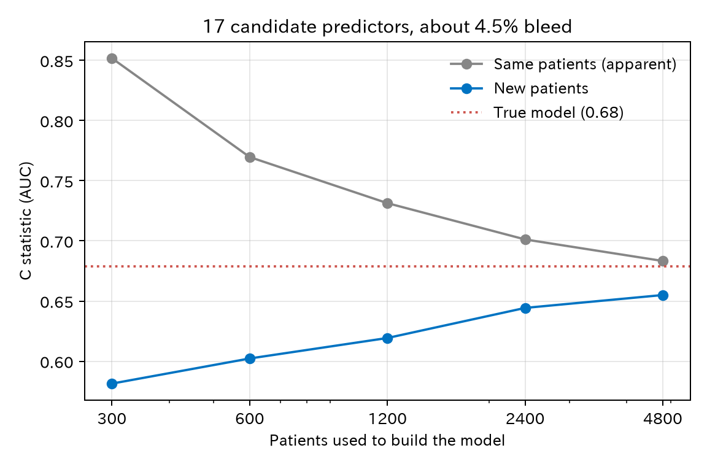
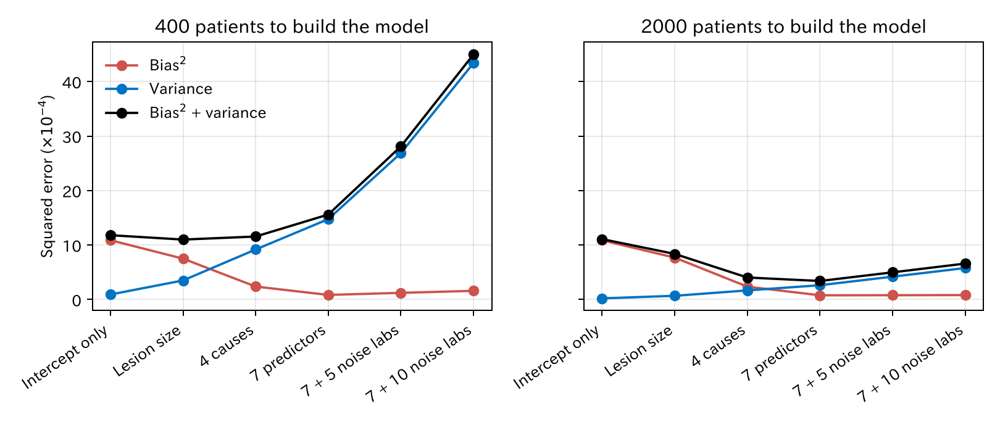
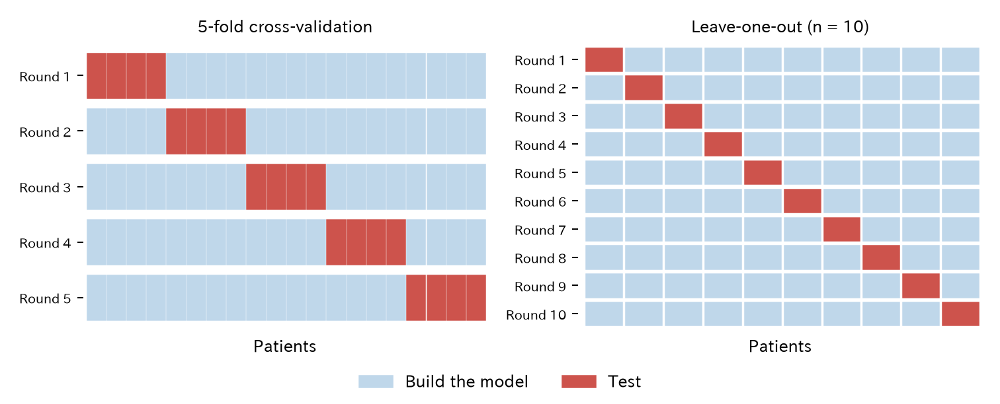
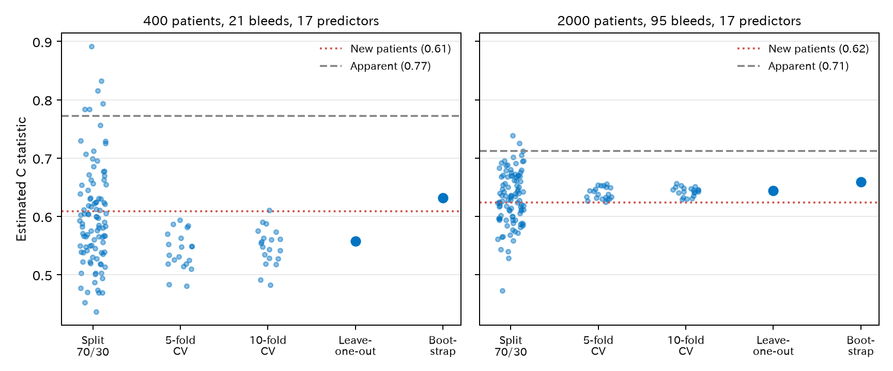

# 9. 過学習と汎化

予測モデルは、モデルを作成するのに使ったデータでは実際より良く見えます。この章では、その「見かけの良さ」がどこから来るか、どう見積もるかを見ます。

[← 目次](index.md) · [← 第 8 章](prediction-model.md)

## 9.1 モデルを作成するのに使ったデータでは良く見える {#apparent}

予測モデルの目的は、**まだ見ていない患者**で当てることです。この力を**汎化**（generalization）と呼びます。モデルを作成するのに使ったデータでの成績（**見かけの成績**、apparent performance）は、汎化の成績より良くなります。モデルが、そのデータにたまたまあった偶然のパターンまで覚えてしまうからです。これを**過学習**（overfitting）と呼びます。

!!! note "経験誤差と汎化誤差"
    統計学習や機械学習の本では、二つの成績を誤差の言葉で呼びます。

    - **経験誤差**（empirical error。訓練誤差 training error とも）：モデルを作成するのに使ったデータでの誤差。見かけの成績の裏返し
    - **汎化誤差**（generalization error）：同じ集団から来る新しい患者での誤差の期待値。本当に知りたいもの

    経験誤差は汎化誤差より小さく出ます。その差が過学習の大きさです。この章で見る交差検証やブートストラップは、この差を見積もって汎化誤差に近づける方法です。

シミュレーションでは、同じ仕組みの「新しい患者」を 5 万人作れます。400 人（出血 21 人）でモデルを作り、新しい患者で確かめました。出血と関係のない検査値を 10 個足したモデルも作りました。

| モデル | 係数の数 | 1 係数あたりの出血数 | C 統計量（モデル作成に使ったデータ） | C 統計量（新しい患者） | 較正の傾き（新しい患者） |
|--------|---------|-------------------|----------------------|---------------------|---------------------|
| 七つの変数 | 7 | 3.0 | 0.73 | 0.64 | 0.55 |
| 七つ + 関係のない検査値 10 個 | 17 | 1.2 | 0.77 | 0.61 | 0.35 |

[CSV](../examples/assets/theory_bleeding/ch8_apparent.csv)

C 統計量は、出血した人の予測確率が出血しなかった人より高い割合です（第 10 章）。0.5 は当てずっぽう、1 は完全です。

- 関係のない検査値を足すと、モデルを作成するのに使ったデータでは **良くなり**（0.73 → 0.77）、新しい患者では **悪くなりました**（0.64 → 0.61）。
- **較正の傾き**は、新しい患者で予測確率がどのくらい当たるかの指標です。1 なら理想です。1 より小さいのは、予測が極端すぎる（高い人を高く、低い人を低く見積もりすぎる）ことを意味します。0.35 は、予測の差を 3 分の 1 に縮めてやっと合う、ということです。

## 9.2 学習曲線 {#learning-curve}

モデルを作る人数を変えて、同じことを 30 回ずつ繰り返しました。変数は 17 個のままです。



[CSV](../examples/assets/theory_bleeding/ch8_learning.csv)

- 300 人で作ると、モデルを作成するのに使ったデータでは 0.85 ですが、新しい患者では 0.58 です。ほとんど当てずっぽうです。
- 人数が増えるほど二つの線は近づき、本当のモデルの値（0.68）に寄っていきます。
- モデルを作成するのに使ったデータでの成績は、人数が少ないほど**良く**見えます。少ない例数で「よく当たるモデルができた」は、まず疑うべきです。

下の図は、9.1 と 9.2 の実験を、本と同じ作り方で作った別のデータでまねたものです（例として作ったデータです）。400 人か 2000 人でモデルを作り、出血と関係のない検査値を 0–30 個足していきます。成績は、同じ作り方で作った新しい患者 5 万人で測ります。データが本と違うので、数字は 9.1 の表と少しずれます（400 人では出血 23 人です）。検査値を足すほど、モデルを作成するのに使ったデータでの C 統計量は上がり、新しい患者の C 統計量と較正の傾きは下がります。2000 人にすると、二本の線の開きが小さくなります。

<div class="sx-widget" data-widget="overfitting">この図を動かすには JavaScript が必要です。</div>

## 9.3 バイアスと分散 {#bias-variance}

過学習は、予測の誤差を三つに分けると見通しがよくなります。新しい患者での誤差（予測確率と実際の結果 0 または 1 の差の 2 乗の平均）は、次の和になります。

$$
\text{誤差} = \text{減らせない誤差} + \text{バイアス}^2 + \text{分散}
$$

- **減らせない誤差**は、本当の確率がわかっていても残る誤差です。出血の確率が 5% の患者が実際に出血するかどうかは、偶然で決まります。
- **バイアス**（bias、偏り）は、違う患者でモデルを何度も作り直したとき、予測の平均が本当の確率からずれる大きさです。モデルが単純すぎると大きくなります。
- **分散**（variance）は、作り直すたびに予測がどのくらいぶれるかです。例数に比べて係数が多いと大きくなります。

ここでのバイアスは予測確率の偏りです。第 II 部で扱う交絡によるバイアス（効果の推定値の偏り）とは、偏りを測る相手が違います。

シミュレーションで、同じ作り方のデータからモデルを 200 回作り直し、新しい患者 5000 人で誤差を分けました。図の横軸は、左ほど単純なモデルです。4 causes は出血の原因のうちクリップ以外の四つ（年齢、抗血栓薬、病変径、近位結腸）、7 predictors は第 8 章の七つの変数です。

=== "図"

    

    [CSV](../examples/assets/theory_bleeding/ch8_bias_variance.csv)

=== "コード"

    ```python
    import numpy as np
    from statract import fit_glm

    # p_true: 新しい患者の本当の出血確率（シミュレーションなのでわかる）
    preds = []
    for r in range(200):
        d = simulate(n=400, seed=r)          # 同じ作り方の別のデータ
        fit = fit_glm(d, formula, family="binomial")
        preds.append(fit.predict(test, kind="response"))
    preds = np.vstack(preds)

    bias2 = np.mean((preds.mean(axis=0) - p_true) ** 2)
    variance = np.mean(preds.var(axis=0))
    ```

- 切片だけ、病変径だけの単純なモデルは、バイアスが大きく、分散は小さくなります。
- 変数を足すとバイアスは減り、分散は増えます。関係のない検査値を足しても、バイアスはもう減らず、分散だけが増えます。
- 二つの和が最も小さいモデルは、例数で変わります。400 人（出血は約 18 人）では病変径だけのモデル、2000 人では 7 変数のモデルでした。例数が増えると分散が小さくなり、変数の多いモデルの利点が生きてきます。

過学習は、分散が大きすぎる状態です。逆に、モデルが単純すぎてバイアスが大きい状態を**過小適合**（underfitting）と呼びます。正則化（[第 11 章](regularization.md)）は、わざと少しバイアスを入れるかわりに、分散を大きく減らす方法です。

## 9.4 例数の目安 {#sample-size}

過学習の強さは、例数そのものより**イベントの数**（ここでは出血の数）と、推定する係数の数の比で決まります。昔から「1 変数あたりイベント 10 以上」（events per variable、EPV）という目安が使われてきました。

しかしこれは目安にすぎません。必要な例数は、イベントの割合、期待する当たりのよさ、許せる過学習の大きさで変わります。Riley ら [@Riley2020-vc] は、これらから必要な例数を計算する方法を示しています。このデータでは、係数 7 個に出血 21 人（EPV 3）では明らかに足りません。

もう一つ大事なのは、**候補にした変数の数**です。$P$ 値で 20 個から 7 個を選んだなら、係数は 7 個でも、過学習は 20 個ぶん起きています。選ぶ過程そのものがデータに合わせているからです。

## 9.5 汎化の成績を見積もる {#validation}

現実には「新しい患者 5 万人」はいません。手元のデータだけで汎化の成績を見積もる方法を、**内部検証**（internal validation）と呼びます。主な方法は四つです。

| 方法 | やり方 | モデルを作る回数 | 長所 | 短所 |
|------|--------|---------------|------|------|
| 分割 | 例えば 7 割で作り、3 割で確かめる | 1 | わかりやすい | 例数が減る。分け方で結果が大きくぶれる |
| $k$ 分割交差検証 | $k$ 等分し、$k-1$ 個で作り 1 個で確かめるのを $k$ 回 | $k$ | データを無駄にしない | 分け方で少しぶれる |
| 一つ抜き交差検証（leave-one-out cross-validation、LOOCV） | 一人だけ抜いて作り、その一人で確かめるのを $n$ 回 | $n$ | 分け方によるぶれがない | 計算が多い。C 統計量は低めに出やすい |
| ブートストラップ | 復元抽出したデータで作り、楽観度を測って引く | 数百 | 全員でモデルを作れる。少ない例数でも使える | 考え方が少し難しい |

どの方法でも、最後に報告するモデルは**全員で作ったモデル**です。内部検証は、そのモデルを作った「手順」が新しい患者でどのくらい当たるかを見積もるものです。

## 9.6 分割 {#split}

データをランダムに二つに分け、片方（学習データ）でモデルを作り、もう片方（テストデータ）で成績を測ります。考え方はいちばん素直です。

しかし例数が少ないときは勧められません。

- モデルを作る例数が 7 割に減り、モデルそのものが悪くなります。
- 確かめる例数も 3 割しかなく、成績の推定がぶれます。
- **どう分けたか**で結果が大きく変わります（9.10 で見ます）。

「別の病院」や「後の時期」で分けるのは、ランダムな分割とは意味が違います。これは外部検証に近く、時期や施設をまたいで使えるかを確かめられます。

## 9.7 交差検証 {#cross-validation}

**交差検証**（cross-validation、CV）は、分割を何度も行って、全員を一度ずつテストに使う方法です。$k$ 分割交差検証（$k$-fold CV）では、次のようにします。

1. 患者をランダムに $k$ 個のグループ（fold）に分けます。$k$ は 5 か 10 がよく使われます。
2. 1 番目のグループを抜き、残りの $k-1$ 個でモデルを作ります。抜いたグループの患者の予測確率を計算します。
3. 2 番目、3 番目、… と、全部のグループで同じことをします。
4. 全員が一度ずつ「自分を含まないモデル」で予測されたことになります。この予測で成績を計算します。



=== "コード"

    ```python
    import numpy as np
    import polars as pl
    from statract import fit_glm, roc_curve

    k = 10
    folds = np.random.default_rng(1).permutation(np.arange(dev.height) % k)
    pred = np.empty(dev.height)
    for j in range(k):
        hold = folds == j
        fit = fit_glm(dev.filter(pl.Series(~hold)), formula, family="binomial")
        pred[hold] = fit.predict(dev.filter(pl.Series(hold)), kind="response")
    roc_curve(dev["bleed"], pred).auc   # 交差検証による C 統計量
    ```

注意点が三つあります。

- **モデルを作る手順を全部、各回でやり直します。** 変数を $P$ 値で選んだなら、その選択も fold ごとに行います。全員で変数を選んでから交差検証すると、選択のぶんの過学習が見えなくなります。
- **C 統計量のまとめ方は二通りあります。** 一つは、全員の予測を集めてから一つの C 統計量を計算する方法です（**まとめて計算**、上のコード）。もう一つは、グループごとに C 統計量を計算して平均する方法です（**グループごとの平均**）。まとめて計算すると、違うモデルで作った予測どうしも比べることになります。モデルごとに予測確率の高さ（較正）が少しずつずれていると、それぞれのグループの中では順番がよく当たっていても、まとめた C 統計量は下がります。グループごとの平均にはこのずれが入りませんが、イベントが少ないと不安定です。このデータを 10 分割すると、1 つのグループの出血は 2 人ほどで、出血のいないグループは計算できません。どちらで計算したかを必ず書いてください。この章の比較（9.10）では、両方を示します。
- **分け方でも結果が変わります。** 分割ほどではありませんが、ランダムに分け直すと値が動きます。分け方を変えて何度も繰り返し（繰り返し交差検証、repeated CV）、平均をとると安定します。

## 9.8 一つ抜き交差検証（LOOCV） {#loocv}

$k$ を患者の数 $n$ まで増やしたものが**一つ抜き交差検証**（LOOCV）です。一人だけ抜いて残りの $n-1$ 人でモデルを作り、抜いた一人を予測します。これを全員について $n$ 回繰り返します。

LOOCV の特徴は次のとおりです。

- **ランダムな要素がありません。** 誰を抜くかが決まっているので、何度やっても同じ結果になります。
- **モデルを作る例数がほとんど減りません。** $n-1$ 人で作るので、全員で作ったモデルとほぼ同じモデルを評価できます。
- **計算が多くなります。** モデルを $n$ 回作ります。ただし線形回帰では、一回の計算で全員ぶんの結果が出る公式があります（[数学補 A6](math/vectors-matrices.md#loocv-shortcut)）。
- **ばらつきが大きくなります。** $n$ 個のモデルはほとんど同じなので、結果はその一つのデータに強く依存します。データが変わると LOOCV の値も大きく変わります。
- **C 統計量は低めに出やすくなります。** 出血した一人を抜くと、残りのデータでは出血割合が少し下がり、その人の予測確率が少し下がります。出血しなかった人ではこの逆が起きます。この小さなずれが毎回「不利な向き」に入るため、まとめた C 統計量が低めになります。

モデルを $n$ 回作り直さずに LOOCV を近似する方法として、AIC（Akaike information criterion、赤池情報量規準）や WAIC（widely applicable information criterion、広く使える情報量規準）などの**情報量規準**もあります。AIC は尤度を、WAIC は基本的にベイズ推論を前提にする発展的な内容なので、[数学補 A8](math/information-criteria.md) にまとめました。

## 9.9 ブートストラップ {#bootstrap}

ブートストラップでは、次のことを何百回も繰り返します。

1. 元のデータから、同じ人数を**復元抽出**（同じ人を何度選んでもよい）してデータを作ります。
2. そのデータでモデルを作り、そのデータでの成績（見かけ）と、元のデータでの成績を測ります。
3. 二つの差が、そのモデルの「楽観度」（optimism）です。

楽観度の平均を、元のデータでの見かけの成績から引くと、汎化の成績の見積もりになります。

=== "コード"

    ```python
    from statract import validate_logistic

    val = validate_logistic(dev, formula, B=200, seed=8)
    # Dxy は 2 × (C − 0.5)。C = Dxy / 2 + 0.5
    ```

400 人、17 変数のモデルで行いました。

| 指標 | 見かけ | 楽観度 | 補正後 | 新しい患者（本当の値） |
|------|-------|-------|-------|-------------------|
| C 統計量 | 0.77 | 0.14 | 0.63 | 0.61 |
| 較正の傾き | 1.00 | 0.52 | 0.48 | 0.35 |

[CSV](../examples/assets/theory_bleeding/ch8_bootstrap.csv)

補正後の値は、新しい患者での本当の値にかなり近づきました。見かけの 0.77 をそのまま報告すると、大きく見誤ります。ただし、補正しても少し楽観的です。ブートストラップは過学習を「見積もる」ものであり、なくすものではありません。

## 9.10 四つの方法を比べる {#compare}

同じデータに四つの方法を使い、新しい患者での本当の値と比べました。分割は分け方を変えて 100 回、5 分割と 10 分割の交差検証は 20 回ずつ繰り返しています。一つの点が一回の結果です。比べやすいように、例数が少ない場合（400 人、出血 21 人）と、比較的多い場合（2000 人、出血 95 人）を並べました。変数はどちらも 17 個です。



[CSV](../examples/assets/theory_bleeding/ch8_cv_summary.csv)

| 方法 | 400 人（本当の値 0.61） | 2000 人（本当の値 0.62） |
|------|----------------------|-----------------------|
| 見かけ | 0.77 | 0.71 |
| 分割 7:3（100 回） | 平均 0.60、0.44–0.89 | 平均 0.63、0.47–0.74 |
| 5 分割 CV（20 回） | 平均 0.54、0.48–0.59 | 平均 0.64、0.62–0.66 |
| 5 分割 CV、グループごとの平均（20 回） | 平均 0.62、0.55–0.69 | 平均 0.65、0.63–0.66 |
| 10 分割 CV（20 回） | 平均 0.55、0.48–0.61 | 平均 0.64、0.63–0.66 |
| 10 分割 CV、グループごとの平均（20 回） | 平均 0.67、0.58–0.78 | 平均 0.65、0.63–0.70 |
| LOOCV | 0.56 | 0.64 |
| ブートストラップ | 0.63 | 0.66 |

読み取れることは次のとおりです。

- **分割は、平均すれば当たっていても、一回ごとのぶれがとても大きくなります。** 400 人では、たまたまの分け方で 0.44 にも 0.89 にもなります。実際の研究では分割は一回しか行わないので、どの値を引くかは運しだいです。
- **例数が比較的多いと、交差検証、LOOCV、ブートストラップはほぼ一致しました**（0.64–0.66）。見かけの 0.71 よりずっと本当の値に近いものの、本当の値 0.62 よりはまだ少し高めです。また、変数 17 個に対して出血 95 人は、十分な例数とはいえません。これは一つのデータでの結果なので、ほかのデータでも同じように一致するとは限りません。
- **例数が少ないと、どの方法も粗くなります。** 400 人では、予測をまとめて計算した交差検証と LOOCV は低め（0.54–0.56）、ブートストラップは少し高め（0.63）に出ました。低めに出た理由は一つではありません。交差検証では 1 割から 2 割少ない人数でモデルを作るので、そのぶん成績が下がります。それに加えて、出血 21 人のデータでは抜く患者によってモデルの予測確率の高さが大きく変わり、まとめて計算するとそのずれで C 統計量が下がります（9.7、LOOCV では 9.8 の「不利な向き」のずれ）。グループごとの平均にするとこのずれは消え、0.62（5 分割）と 0.67（10 分割）になりました。ただし、グループの出血は 2–4 人ほどなので、一回ごとのぶれが大きく（10 分割では 0.58–0.78）、高めにも出ます。2000 人では、二つのまとめ方の差は 0.01 ほどです。

つまり内部検証は、例数の不足を補ってはくれません。イベントが少ないなら、まずモデルを小さくする（変数を減らす、正則化する）ことを考えます。

## 9.11 過学習を減らすには {#reduce}

- 例数（イベントの数）を増やします。
- 候補の変数を、臨床の知識で先に絞ります。$P$ 値による選択はしません。
- 係数を小さく縮めます（**正則化**、第 11 章）。較正の傾きが 1 より小さいのは「係数が大きすぎる」ことなので、縮めるのは理にかなっています。
- 作ったモデルは、別の施設や別の時期の患者でも確かめます（**外部検証**）。

実データで、分割（7 割で作り 3 割で確かめる）とブートストラップによる内部検証を並べた例は、[予測モデルの較正と DCA](../examples/pred_support.md) にあります。DCA は決定曲線分析（decision curve analysis）で、第 10 章で扱います。

## 文献 {#references}

教科書では、Hastie ら [@Hastie2009-book] の第 7 章が交差検証と情報量規準を扱っています。数式の多い本です。日本語で読むなら、同じ著者らの入門書の訳 [@James2018-book-ja] がやさしく、第 5 章で交差検証を R の演習つきで説明しています。

::: {#refs}
:::


## まとめ

- 予測モデルは、モデルを作成するのに使ったデータでは実際より良く見えます（過学習）。例数が少なく、変数が多いほど強くなります。
- 関係のない変数を足すと、モデルを作成するのに使ったデータでは良くなり、新しい患者では悪くなります。
- 予測の誤差は、減らせない誤差、バイアスの 2 乗、分散に分けられます。単純すぎるとバイアスが、複雑すぎると分散が大きくなります。
- 過学習の強さは、イベントの数と、候補にした変数の数で決まります。
- 汎化の成績は、交差検証、LOOCV、ブートストラップで見積もります。報告するのは全員で作ったモデルで、内部検証はその手順を評価します。
- 交差検証では、変数選択を含む手順全部を各回でやり直します。
- 分割は一回ごとのぶれが大きく、少ない例数では勧められません。例数が比較的多いと、交差検証、LOOCV、ブートストラップは近い値になりますが、それでも少し楽観的なことがあります。
- 較正の傾きが 1 より小さいのは、予測が極端すぎるしるしです。

**次へ：**[第 10 章 識別と較正](discrimination-calibration.md)
