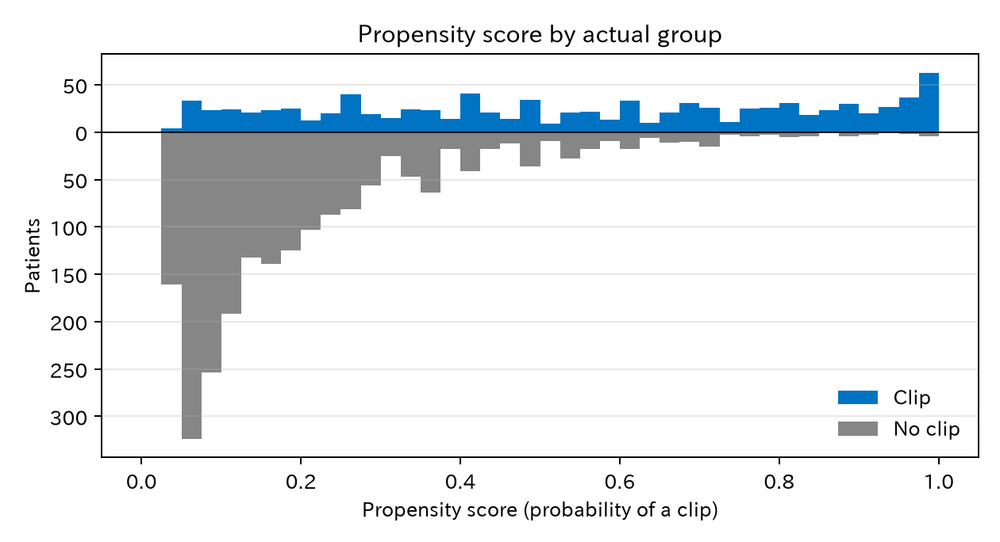
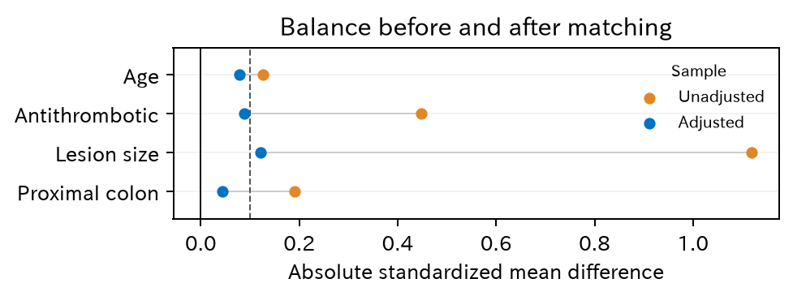

# 4. 傾向スコアマッチング

傾向スコアマッチングは「高度な統計手法」ではありません。治療の選ばれ方の偏り（交絡）を調整して、**比べられる二つの集団を作る**方法です。この章では、バランシングスコアという考え方から傾向スコアを導き、通しの例でマッチングを行います。

[← 目次](index.md) · [← 第 3 章](adjustment-methods.md)

## 4.1 背景がそろった相手を探す {#idea}

クリップをした患者一人ひとりに、背景が**まったく同じ**でクリップをしなかった患者を見つけられれば、その組どうしの比較は公平です。ところが、交絡因子が増えるとこれはすぐに不可能になります。年齢 60 通り、病変径 63 通り、抗血栓薬 2 通り、部位 2 通りだけで、組み合わせは 1 万 5120 通りです。3000 人のデータでは、ほとんどの組み合わせに一人もいません（第 3 章の層別化と同じ問題です）。

## 4.2 バランシングスコア {#balancing-score}

そこで、「全部の変数が同じ」のかわりに、「ある一つの値が同じ」相手を探すことを考えます。どんな値ならよいでしょうか。

交絡因子をまとめて $X$ と書きます。ある値 $b(X)$ が同じ患者どうしで、クリップ群と非クリップ群の $X$ の分布が同じになるとき、$b(X)$ を**バランシングスコア**と呼びます。

$$
X \perp A \mid b(X)
$$

$\perp$ は「無関係（独立）」、$\mid b(X)$ は「$b(X)$ が同じ人たちの中で」という意味です。$b(X)$ をそろえれば、$X$ のすべてが（平均として）そろう、ということです。

- $X$ そのものは、いちばん細かいバランシングスコアです（全部そろえる）。
- いちばん粗いバランシングスコアが**傾向スコア**です。

$$
e(X) = P(A = 1 \mid X)
$$

その患者の背景 $X$ のもとで、クリップをされる確率です。Rosenbaum と Rubin [@Rosenbaum1983-sk] は次のことを示しました。

!!! note "傾向スコアの性質"
    $X$ で調整すれば交換可能になるなら、傾向スコア $e(X)$ だけで調整しても交換可能になります。

何十個の交絡因子があっても、**一つの数**でそろえればよいことになります。傾向スコアが同じ二人は、一人がクリップをされ、もう一人がされなかったのは「同じ確率のくじで、たまたま結果が分かれた」とみなせます。ランダム化を、傾向スコアの層ごとにまねしていることになります。

## 4.3 傾向スコアを推定する {#estimate}

本当の傾向スコアはわからないので、データから推定します。普通は、クリップの有無をアウトカムにしたロジスティック回帰を使います。

$$
\log \frac{e(X)}{1 - e(X)} = \alpha_0 + \alpha_1 \cdot \text{年齢} + \alpha_2 \cdot \text{抗血栓薬} + \alpha_3 \cdot \text{病変径} + \alpha_4 \cdot \text{近位}
$$

第 1 章と同じロジスティック回帰ですが、今度はアウトカムが**出血ではなくクリップ**です。

[傾向スコアモデルのオッズ比 CSV](../examples/assets/theory_bleeding/ch4_ps_model.csv)

抗血栓薬（オッズ比（odds ratio、OR）4.5）、病変径（1 mm あたり OR 1.18）、近位結腸（OR 2.0）でクリップが選ばれやすいことがわかります。

傾向スコアモデルを作るときの注意です。

- 入れる変数は DAG（directed acyclic graph、有向非巡回グラフ、第 2 章）で選びます（交絡因子と、アウトカムの原因）。クリップのあとに決まる変数は入れません。
- 目的は**バランスをとること**で、クリップを当てることではありません。$P$ 値で変数を選んだり、C 統計量でモデルの良し悪しを判断したりはしません。良し悪しは、マッチ後のバランス（4.6）で判断します。

## 4.4 重なりを見る {#overlap}

マッチングの前に、二つの群の傾向スコアの分布を並べます。

=== "図"

    

=== "コード"

    ```python
    from statract import fit_glm, match_sample

    covariates = ["age", "antithrombotic", "size_mm", "proximal"]
    ps_fit = fit_glm(df, "clip ~ " + " + ".join(covariates), family="binomial")
    ps = ps_fit.predict()   # 傾向スコア
    matched = match_sample(df, "clip", covariates, distance=ps_fit.predict(kind="link"), caliper=0.2)
    ```

非クリップ群（下）は傾向スコアの低い所に集まり、クリップ群（上）は全体に広がっています。傾向スコアが 0.9 を超える所にはクリップ群が多く、非クリップ群はほとんどいません。大きな病変で抗血栓薬を飲んでいる患者は、ほぼ全員がクリップされているからです。この所では、比べる相手がいません（**正値性**の問題）。

## 4.5 マッチングする {#matching}

ここでは最もよく使われる方法をとります。

- クリップ群の一人ひとりに、傾向スコアがいちばん近い非クリップ群の一人を組にします（1 対 1 最近傍）。
- 一度組にした相手は使いません（非復元）。
- 傾向スコアのロジット（$\log\{e/(1-e)\}$、$e$ は傾向スコア）の差が、ロジットの標準偏差の 0.2 倍（**キャリパー**）より大きい組は作りません。

キャリパーの幅は、Austin [@Austin2011-dk] がシミュレーションで調べ、勧めたものです。傾向スコアそのものではなく**ロジットの尺度**で測る点に注意してください。傾向スコアは 0 と 1 の近くで目盛りが詰まるので、同じ「0.05 の差」でも、0.5 付近と 0.95 付近では意味が違います。ロジットにすると、この詰まりがなくなります。このデータではロジットの標準偏差が 1.76 なので、キャリパーは 0.35 です。

クリップ群 927 人のうち、組ができたのは **648 人**でした。279 人は外れました。外れた患者は病変径の中央値 34 mm、傾向スコアの平均 0.88 で、組ができた患者（19 mm、0.41）よりずっと「クリップされやすい」患者です。このあたりには非クリップ群の患者がもともと少なく、いたとしても、先に組を作ったクリップ群の患者に使われてしまっています。

!!! warning "誰についての答えか"
    マッチングで推定するのは ATT（average treatment effect on the treated、処置群での平均処置効果。ここではクリップをされた患者での効果）です。ただしキャリパーで外れた患者がいると、答えは「**組ができたクリップ群**での効果」になります。このデータでは、クリップがいちばん効くはずの大きな病変が、多く外れました。

## 4.6 バランスを確かめる {#balance}

マッチングがうまくいったかは、組にした集団で背景がそろったかで判断します。指標には**標準化差**（standardized mean difference、SMD）を使います。二つの群の平均の差を、標準偏差で割ったものです。0.1 未満がそろった目安です。

=== "図"

    

    [CSV](../examples/assets/theory_bleeding/ch4_balance.csv)

=== "マッチ前の Table 1"

    --8<-- "examples/assets/theory_bleeding/ch4_table1_before_gt.md"

=== "マッチ後の Table 1"

    --8<-- "examples/assets/theory_bleeding/ch4_table1_after_gt.md"

=== "コード"

    ```python
    from statract import plot_love, write_tableone_artifacts

    balance = matched.balance()
    plot_love(balance.rename({"smd_all": "diff_unadjusted", "smd_matched": "diff_adjusted"}), "love_plot.png")

    kept = matched.frame().filter(pl.col("weights") > 0)
    write_tableone_artifacts(out, "table1_after", df=kept, params=params, hue="clip", add_smd=True)
    ```

この図を **Love plot** と呼びます。マッチ前は病変径の標準化差が 1.12、抗血栓薬が 0.45 と大きくずれていました。マッチ後はほとんどが 0.1 未満になりました。病変径はまだ 0.12 残っています。その場合は、キャリパーを狭める、傾向スコアモデルに病変径の曲線（スプラインなど）を足す、20 mm 以上かどうかで完全一致させる、などを試します。マッチ後の Table 1 は標準偏差をマッチ後の集団で計算し直すので、分母をマッチ前のまま使う Love plot と少し違う値になります（病変径は Love plot で 0.12、Table 1 で 0.16）。

下の図で、キャリパーを動かしてみてください。本文と同じ 3000 人で、4.5 と同じ方法（1 対 1 最近傍、非復元）で組を作り直します。図は 4.4 の傾向スコアの分布に、組ができた患者と外れた患者の色を重ねたものです。標準化差の分母は、Love plot と同じく、マッチ前の全員で計算した標準偏差のまま変えません。キャリパーを狭めると病変径の標準化差は小さくなりますが、外れるクリップ群が増えます。はじめは本文と同じロジットの尺度です。尺度を「傾向スコア」に切り替えると、傾向スコアそのものの標準偏差を物差しにしたキャリパーになり、外れる患者が 279 人から 311 人に増えます。

<div class="sx-widget" data-widget="ps-caliper">この図を動かすには JavaScript が必要です。</div>

バランスの確認に $P$ 値は使いません。$P$ 値は例数で変わるので、ずれの大きさを表さないからです。

## 4.7 効果を推定する {#effect}

組にした 648 組で出血割合を比べます。

| | 出血割合 |
|--|-----------|
| 非クリップ（648 人） | 6.3% |
| クリップ（648 人） | 3.7% |
| リスク差 | −2.6 ポイント（95% 信頼区間 −4.9–−0.3） |

[CSV](../examples/assets/theory_bleeding/ch4_matched_summary.csv)

組ができたクリップ群 648 人での本当の効果は −1.9 ポイントで、推定値は区間の中に入っています。外した 279 人のぶん例数が減るので、区間は広めです。

### 組を考えた信頼区間 {#matched-inference}

1 対 1 マッチングでは、組の二人は背景が似ているので、結果も似やすくなります。二人を別々の独立な患者として扱うと、この**組の中の依存**を無視することになります [@Austin2011-xj]。どの物差しで効果を表すかで、組の扱い方も変わります。

| 物差し | 推定値 | 95% 信頼区間 | 区間の求め方 |
|--------|-------|-----------|-----------|
| リスク差 | −2.6 ポイント | −5.0–−0.3 | 組を無視（頑健分散） |
| リスク差 | −2.6 ポイント | −4.9–−0.3 | 組ごとのクラスター頑健分散 |
| リスク差 | −2.6 ポイント | −5.5–−0.5 | 傾向スコアの推定とマッチングごとやり直すブートストラップ（500 回） |
| リスク比 | 0.59 | 0.35–0.93 | 組ごとのブートストラップ（2000 回） |
| オッズ比 | 0.55 | 0.32–0.94 | 条件付きロジスティック回帰（組を層にする） |

[CSV](../examples/assets/theory_bleeding/ch4_matched_effects.csv)

=== "コード"

    ```python
    import numpy as np
    from statract import cluster_covariance, conditional_logit, fit_glm, match_sample

    ps_fit = fit_glm(df, "clip ~ age + antithrombotic + size_mm + proximal", family="binomial")
    matched = match_sample(df, "clip", covariates, distance=ps_fit.predict(kind="link"), caliper=0.2)
    kept = matched.frame().filter(pl.col("weights") > 0)

    # リスク差：組（subclass）ごとのクラスター頑健分散
    fit = fit_glm(kept, "bleed ~ clip", family="gaussian")
    fit.covariance = cluster_covariance(fit, kept["subclass"].to_numpy(), kind="HC0", adjust=False)

    # オッズ比：組を層にした条件付きロジスティック回帰
    conditional_logit(kept, "bleed ~ clip + strata(subclass)").tidy()
    ```

- **リスク差**は、組ごとの差（クリップの人の結果 − 相手の結果）の平均と同じです。分散は組を単位に計算します（組ごとのクラスター頑健分散、または組の差の標準偏差から）。出血はまれで、組の二人がそろって出血することはほとんどないので、このデータでは組を無視しても区間はほぼ同じでした。結果が組の中でよく似る場合（例えば施設や時期でも組をそろえた場合）は、差が大きくなります。
- **リスク比**は、組ごとの差の平均では作れません。ここでは組を単位に組み直すブートストラップで区間を作りました。
- **条件付きロジスティック回帰**は、組を層にして、組の中での比較だけからオッズ比を推定します。答えは「同じ組の中で比べた」**条件付きのオッズ比**で、組にした集団全体の周辺オッズ比とも、リスク差とも別の量です（第 1 章、第 14 章）。出血がまれなので、このデータではリスク比に近い値になっていますが、いつもそうなるわけではありません。

もう一つ注意があります。上の区間のうち最初の二つは「この組み合わせができた」ことを固定した区間で、傾向スコアを推定したことや、誰と誰が組になったかの偶然を含みません。マッチングの手順全体のぶれを含めるには、データから患者を選び直し、傾向スコアの推定とマッチングを毎回やり直すブートストラップがあります（表の 3 行目）。ただし、非復元の最近傍マッチングでは、ブートストラップの理論的な裏づけが完全ではないことが知られています [@Stuart2010-ke]。このデータでは、どの方法でも区間は大きく変わりませんでした。

## 4.8 傾向スコアマッチングの限界 {#limits}

- **測っていない交絡は調整できません**。傾向スコアは測った変数の要約にすぎません。
- **組ができない患者を捨てます**。答えの対象が変わり、例数も減ります。
- **傾向スコアのモデルに頼ります**。ただし良し悪しはバランスで確かめられます。
- マッチングは、効果を推定する前に背景をそろえて見せられるのが長所です。マッチ後の Table 1 を示せば、読者も比較の公平さを確かめられます。

## 文献 {#references}

日本語では、星野 [@Hoshino2009-book] が傾向スコアを理論から詳しく説明しています。ローゼンバウム [@Rosenbaum2024-book-ja] は傾向スコアの提案者の一人による入門書で、数式をほとんど使いません。田中 [@Tanaka2022-book-rubin] の第 5、6 章は、傾向スコアの性質と、医学研究での交絡因子の選び方を扱っています。

::: {#refs}
:::

statract でのマッチングの通しの例は、[傾向スコアマッチング（RHC）](../examples/psm_rhc.md) にあります。RHC は右心カテーテル（right heart catheterization、RHC）のデータです。

## まとめ

- バランシングスコアは、その値が同じ患者どうしで背景の分布がそろう値です。傾向スコアはその中でいちばん粗いものです。
- 交絡因子で調整すれば交換可能なら、傾向スコアだけで調整しても交換可能です。多くの変数を一つの数にまとめられます。
- 傾向スコアは、治療をアウトカムにしたロジスティック回帰で推定します。目的は予測ではなくバランスです。
- マッチングの前に重なりを、あとにバランス（標準化差、Love plot、マッチ後の Table 1）を確かめます。
- キャリパーで外れた患者がいると、答えの対象が変わります。

次の[第 5 章](iptw.md)では、傾向スコアを重みとして使います。

**次へ：**[第 5 章 IPTW](iptw.md)  
**発展（第 5、6 章）を読み飛ばす場合：**[第 7 章 予測モデルとしてのロジスティック回帰](prediction-model.md)
