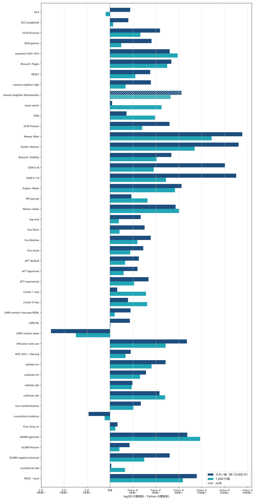

# 速度と R との差

公開データで **同じ表** を Python（このライブラリ）と R に渡し、壁時計と数値差を測った結果。設計・許容差・データの引用は [benchmark-plan](https://github.com/mizuy/statract/blob/main/dev-notes/benchmark-plan.md)。R 関数の対応は [vs R](vs-r.md)。

## 計測の条件

- 計測日：2026-10-09（全 102 タスク）
- 機械：Apple M4 Max（macOS）。BLAS / OMP スレッドは 1
- Python：statract 0.1.0。混合モデルは lme-python（`fit_mixed`）
- 回数：ウォームアップ 1 回のあと 5 回の中央値（mice は 1 回）
- データ：UCI Adult、Bike Sharing、Vanderbilt SUPPORT2、Harvard Dataverse STAR（file 666716）。実行時に取得し、リポジトリには入れない
- 出典：[`comparison.csv`](benchmarks/comparison.csv)（344 行）。表は `bench/render_tables.py`、図は `bench/plot_charts.py` が作る

R の秒はおおむね 1 ms 刻み。R 側が 0 s と記録されたタスクは比を出さない。

## 速度の倍率

軸は log2(R の壁時計 / Python の壁時計)。0 が等速で、右ほど Python が速い。目盛りは何倍かを示す。タスクごとに、大きい側（濃い青）と 1,000 行側（青緑）の棒を並べた。斜線は、数値比較が許容差の外だったという印。R のタイマーが 0 s のタスク（Wald、尤度比、t 検定、比率の検定、p 値の補正）は載せていない。

## 表の読み方

| 列 | 意味 |
|----|------|
| 手法 | `bench` のタスク |
| n | 切ったあとの行数 |
| Python / R | そのタスクの壁時計 |
| 比 | Python ÷ R。1 未満なら Python が速い |
| vs R | 全チェックの結果。括弧の数は比べた量の数。許容差は [vs-r.md](vs-r.md)。「緩めた許容差」は benchmark-plan で緩めたタスク |

Fine–Gray は SUPPORT2 に作った競合原因（院内死亡と退院後死亡）で `crr` と比べる。

## 大きい側

SUPPORT2 の生存は完全ケース 9,103 行。STAR の変量傾きは生徒単位の別スライス（n=10,000）。

| 手法 | API | n | Python | R | 比 | vs R |
|------|-----|--:|------:|--:|---:|------|
| OLS | `fit_ols` / `lm` | 10000 | 2.17 ms | 4.00 ms | 0.542 | 一致（5） |
| OLS（重み） | `fit_ols(weights=)` / `lm` | 10000 | 2.29 ms | 4.00 ms | 0.572 | 一致（5） |
| GLM 二項 | `fit_glm(binomial)` / `glm` | 10000 | 8.60 ms | 39.00 ms | 0.220 | 一致（3） |
| GLM ガンマ | `fit_glm(gamma)` / `glm` | 10000 | 5.69 ms | 20.00 ms | 0.285 | 一致（2） |
| sandwich HC0–HC5 | `hc_covariance` / `vcovHC` | 10000 | 1.97 ms | 12.00 ms | 0.164 | 一致（6） |
| Wald | `wald_test` / `waldtest` | 10000 | 0.023 ms | 0 s | — | 一致（2）。R のタイマーが 0 |
| 尤度比 | `likelihood_ratio_test` / `lrtest` | 10000 | 0.014 ms | 0 s | — | 一致（2）。R のタイマーが 0 |
| Breusch–Pagan | `breusch_pagan_test` / `bptest` | 10000 | 1.09 ms | 7.00 ms | 0.156 | 一致（4） |
| RESET | `ramsey_reset_test` / `resettest` | 10000 | 3.25 ms | 11.00 ms | 0.296 | 一致（2） |
| 最近傍 logit | `match_sample` / `matchit` | 10000 | 23.53 ms | 81.00 ms | 0.290 | 一致（2）。16 組は共変量が同じ別の対照（タイの破り方） |
| 最近傍 マハラノビス | `distance="mahalanobis"` | 10000 | 255.9 ms | 2.219 s | 0.115 | tol 外（1/1）。組が一致しない（3247 組中 2278 組が同じ）。LAPACK のビルドに依存 |
| 完全一致 | `method="exact"` | 10000 | 1.87 ms | 2.00 ms | 0.935 | 一致（1） |
| CEM | `method="cem"` | 10000 | 7.89 ms | 13.00 ms | 0.607 | 一致（1） |
| GLM ポアソン | `fit_glm(poisson)` / `glm` | 10000 | 13.54 ms | 82.00 ms | 0.165 | 一致（3） |
| Newey–West | `newey_west_covariance` / `NeweyWest` | 10000 | 4.99 ms | 272.0 ms | 0.018 | 一致（1） |
| Durbin–Watson | `durbin_watson_test` / `dwtest` | 10000 | 1.05 ms | 51.00 ms | 0.020 | 一致（2） |
| Breusch–Godfrey | `breusch_godfrey_test` / `bgtest` | 10000 | 4.70 ms | 30.00 ms | 0.157 | 一致（4） |
| GAM k=8 | `gam` / `mgcv::gam` | 10000 | 2.53 ms | 82.00 ms | 0.031 | 一致（4） |
| GAM k=10 | 同上 | 10000 | 2.43 ms | 110.0 ms | 0.022 | 一致（4） |
| Kaplan–Meier | `survival_curve` / `survfit` | 9103 | 0.460 ms | 4.00 ms | 0.115 | 一致（3） |
| KM（群） | `survival_curve(by=)` | 9103 | 1.57 ms | 3.00 ms | 0.524 | 一致（3） |
| Nelson–Aalen | `kind="nelson_aalen"` | 9103 | 0.413 ms | 3.00 ms | 0.138 | 一致（3） |
| log-rank | `log_rank` / `survdiff` | 9103 | 1.18 ms | 3.00 ms | 0.394 | 一致（6） |
| Cox Efron | `cox_ph` / `coxph` | 9103 | 7.36 ms | 21.00 ms | 0.350 | 一致（3） |
| Cox Breslow | `ties="breslow"` | 9103 | 4.97 ms | 17.00 ms | 0.292 | 一致（3） |
| Cox 層 | `strata=` | 9103 | 7.66 ms | 21.00 ms | 0.365 | 一致（3） |
| AFT Weibull | `accelerated_failure` / `survreg` | 9103 | 7.94 ms | 19.00 ms | 0.418 | 一致（3） |
| AFT lognormal | 同上 | 9103 | 7.81 ms | 18.00 ms | 0.434 | 一致（3） |
| AFT exponential | 同上 | 9103 | 5.92 ms | 19.00 ms | 0.312 | 一致（3） |
| クラスタ 1-way | `cluster_covariance` / `vcovCL` | 10000 | 3.22 ms | 4.00 ms | 0.804 | 一致（1）。緩めた許容差 |
| クラスタ 2-way | 同上 2 列 | 10000 | 10.42 ms | 18.00 ms | 0.579 | 一致（1）。緩めた許容差 |
| LMM 変量切片 REML | `fit_mixed` / `lmer` | 10000 | 27.30 ms | 51.00 ms | 0.535 | 一致（5）。緩めた許容差 |
| LMM ML | `method="ml"` | 10000 | 27.42 ms | 50.00 ms | 0.548 | 一致（5）。緩めた許容差 |
| LMM 変量傾き | `slopes=` | 10000 | 617.4 ms | 104.0 ms | 5.936 | 一致（5）。緩めた許容差 |
| t 検定 | `t_test` / `t.test` | 9103 | 0.062 ms | 0 s | — | 一致（10）。R のタイマーが 0 |
| Wilcoxon 順位和 | `wilcox_test` / `wilcox.test` | 9103 | 19.13 ms | 196.0 ms | 0.098 | 一致（4） |
| 比率の検定 | `prop_test` / `prop.test` | 9103 | 0.061 ms | 0 s | — | 一致（5）。R のタイマーが 0 |
| p 値の補正 | `p_adjust` / `p.adjust` | 9103 | 0.005 ms | 0 s | — | 一致（5）。R のタイマーが 0 |
| ROC と DeLong | `roc_curve`, `roc_test` / pROC | 9103 | 6.93 ms | 13.00 ms | 0.533 | 一致（5） |
| validate（ロジスティック） | `validate_logistic` / `rms::validate` | 9103 | 102.2 ms | 549.0 ms | 0.186 | 一致（1） |
| calibrate（ロジスティック） | `calibrate_logistic` / `rms::calibrate` | 9103 | 140.1 ms | 416.0 ms | 0.337 | 一致（2） |
| validate（Cox） | `validate_cox` / `rms::validate` | 9103 | 195.8 ms | 387.0 ms | 0.506 | 一致（1） |
| calibrate（Cox） | `calibrate_cox` / `rms::calibrate` | 9103 | 234.2 ms | 1.046 s | 0.224 | 一致（4） |
| Cox 標準化 | `standardize_cox` / `stdReg2` | 9103 | 37.39 ms | 95.00 ms | 0.394 | 一致（2） |
| 累積発生と Gray 検定 | `cumulative_incidence` / `cuminc` | 9103 | 5.73 ms | 3.00 ms | 1.909 | 一致（6） |
| Fine–Gray（crr） | `fine_gray_regression` / `crr` | 9103 | 1.256 s | 1.579 s | 0.796 | 一致（3） |
| GAMM | `gamm` / `gamm4` | 9103 | 522.9 ms | 5.397 s | 0.097 | 一致（4） |
| GLMM ポアソン | `fit_mixed(poisson)` / `glmmTMB` | 9103 | 214.6 ms | 387.0 ms | 0.554 | 一致（4） |
| GLMM 負の二項 | `fit_mixed(negative_binomial)` / `glmmTMB` | 9103 | 667.3 ms | 4.055 s | 0.165 | 一致（5） |
| 条件付き推論木 | `conditional_tree` / `ctree` | 9103 | 40.42 ms | 42.00 ms | 0.962 | 一致（5） |
| 多重代入と統合 | `impute_chained`, `pool` / `mice` | 9104 | 287.4 ms | 3.956 s | 0.073 | 一致（2） |

許容差の外はマハラノビスの最近傍だけ。マハラノビス距離（Rubin 1980; Stuart 2010）は群内プール共分散の（一般化）逆行列で測る。因子は全水準の指標で符号化するので、プールした共分散が特異になる。そのため同点に近い組の順が LAPACK のビルドで変わる。x86-64 Linux の参照 LAPACK では組が一致し、この macOS では一致しない。

Python が R より遅いのは、変量傾きの LMM（比 5.9）と累積発生（cuminc、比 1.9）。cuminc はどちらも 10 ms 未満。R の `lmer` は変量傾きで `boundary (singular) fit` を出した。

## 1,000 行側

同じタスクの小さいスライス。STAR の小さい側は生徒を切った結果 n=1,002 と n=1,001。

| 手法 | n | Python | R | 比 | vs R |
|------|--:|------:|--:|---:|------|
| OLS | 1000 | 1.14 ms | 1.00 ms | 1.138 | 一致（5） |
| OLS（重み） | 1000 | 0.910 ms | 1.00 ms | 0.910 | 一致（5） |
| GLM 二項 | 1000 | 1.59 ms | 4.00 ms | 0.398 | 一致（3） |
| GLM ガンマ | 1000 | 1.42 ms | 2.00 ms | 0.710 | 一致（2） |
| sandwich HC0–HC5 | 1000 | 0.258 ms | 2.00 ms | 0.129 | 一致（6） |
| Wald | 1000 | 0.024 ms | 0 s | — | 一致（2）。R のタイマーが 0 |
| 尤度比 | 1000 | 0.015 ms | 0 s | — | 一致（2）。R のタイマーが 0 |
| Breusch–Pagan | 1000 | 0.178 ms | 1.000 ms | 0.178 | 一致（4） |
| RESET | 1000 | 0.464 ms | 1.000 ms | 0.464 | 一致（2） |
| 最近傍 logit | 1000 | 4.39 ms | 7.00 ms | 0.627 | 一致（2） |
| 最近傍 マハラノビス | 1000 | 4.46 ms | 28.00 ms | 0.159 | tol 外（1/1）。組が一致しない（330 組中 165 組が同じ）。LAPACK のビルドに依存 |
| 完全一致 | 1000 | 0.210 ms | 1.000 ms | 0.210 | 一致（1） |
| CEM | 1000 | 0.768 ms | 3.00 ms | 0.256 | 一致（1） |
| GLM ポアソン | 1000 | 1.89 ms | 5.00 ms | 0.378 | 一致（3） |
| Newey–West | 1000 | 0.417 ms | 9.00 ms | 0.046 | 一致（1） |
| Durbin–Watson | 1000 | 0.232 ms | 3.00 ms | 0.077 | 一致（2） |
| Breusch–Godfrey | 1000 | 0.488 ms | 2.00 ms | 0.244 | 一致（4） |
| GAM k=8 | 1000 | 1.60 ms | 6.00 ms | 0.267 | 一致（4） |
| GAM k=10 | 1000 | 1.29 ms | 7.00 ms | 0.184 | 一致（4） |
| Kaplan–Meier | 1000 | 0.141 ms | 1.00 ms | 0.141 | 一致（3） |
| KM（群） | 1000 | 0.321 ms | 1.000 ms | 0.321 | 一致（3） |
| Nelson–Aalen | 1000 | 0.124 ms | 1.000 ms | 0.124 | 一致（3） |
| log-rank | 1000 | 0.764 ms | 1.000 ms | 0.764 | 一致（6） |
| Cox Efron | 1000 | 1.50 ms | 2.00 ms | 0.749 | 一致（3） |
| Cox Breslow | 1000 | 1.31 ms | 3.00 ms | 0.438 | 一致（3） |
| Cox 層 | 1000 | 1.62 ms | 3.00 ms | 0.541 | 一致（3） |
| AFT Weibull | 1000 | 1.90 ms | 3.00 ms | 0.632 | 一致（3） |
| AFT lognormal | 1000 | 1.99 ms | 3.00 ms | 0.662 | 一致（3） |
| AFT exponential | 1000 | 1.44 ms | 3.00 ms | 0.481 | 一致（3） |
| クラスタ 1-way | 1002 | 0.336 ms | 1.00 ms | 0.336 | 一致（1）。緩めた許容差 |
| クラスタ 2-way | 1002 | 0.976 ms | 3.00 ms | 0.325 | 一致（1）。緩めた許容差 |
| LMM 変量切片 REML | 1002 | 9.56 ms | 11.00 ms | 0.869 | 一致（5）。緩めた許容差 |
| LMM ML | 1002 | 9.86 ms | 10.00 ms | 0.986 | 一致（5）。緩めた許容差 |
| LMM 変量傾き | 1001 | 47.66 ms | 17.00 ms | 2.803 | 一致（5）。緩めた許容差 |
| t 検定 | 1000 | 0.051 ms | 0 s | — | 一致（10）。R のタイマーが 0 |
| Wilcoxon 順位和 | 1000 | 4.83 ms | 26.00 ms | 0.186 | 一致（4） |
| 比率の検定 | 1000 | 0.056 ms | 0 s | — | 一致（5）。R のタイマーが 0 |
| p 値の補正 | 1000 | 0.005 ms | 0 s | — | 一致（5）。R のタイマーが 0 |
| ROC と DeLong | 1000 | 1.25 ms | 2.00 ms | 0.625 | 一致（5） |
| validate（ロジスティック） | 1000 | 19.89 ms | 70.00 ms | 0.284 | 一致（1） |
| calibrate（ロジスティック） | 1000 | 21.33 ms | 53.00 ms | 0.402 | 一致（2） |
| validate（Cox） | 1000 | 22.77 ms | 44.00 ms | 0.517 | 一致（1） |
| calibrate（Cox） | 1000 | 25.65 ms | 136.0 ms | 0.189 | 一致（4） |
| Cox 標準化 | 1000 | 5.42 ms | 11.00 ms | 0.492 | 一致（2） |
| 累積発生と Gray 検定 | 1000 | 1.18 ms | 1.000 ms | 1.175 | 一致（6） |
| Fine–Gray（crr） | 1000 | 25.56 ms | 30.00 ms | 0.852 | 一致（3） |
| GAMM | 1000 | 52.09 ms | 793.0 ms | 0.066 | 一致（4） |
| GLMM ポアソン | 1000 | 50.49 ms | 67.00 ms | 0.754 | 一致（4） |
| GLMM 負の二項 | 1000 | 126.3 ms | 357.0 ms | 0.354 | 一致（5） |
| 条件付き推論木 | 1000 | 4.45 ms | 7.00 ms | 0.636 | 一致（5） |
| 多重代入と統合 | 1000 | 56.88 ms | 514.0 ms | 0.111 | 一致（2） |

1,000 行側で R より遅いのは、変量傾きの LMM（比 2.8）、cuminc（1.2）、OLS（1.1）。どれも 50 ms 未満。

## 未計測

| 手法 | 理由 |
|------|------|
| `tableone` / `write_tableone_artifacts` | `bench` のタスク表に無い |
| `glmm_gpboost` | experimental extra |
| `plot_survival` など図 | 数値ベンチの対象外 |
